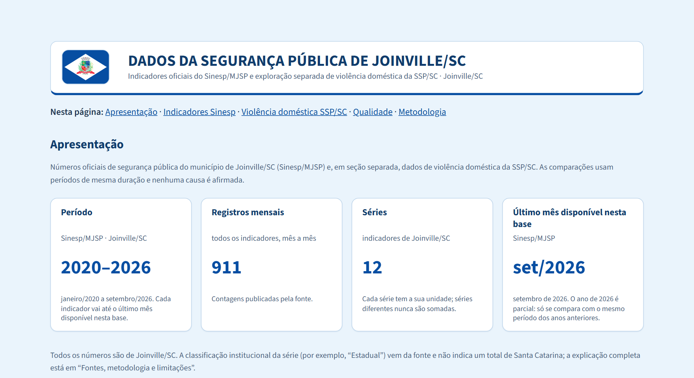
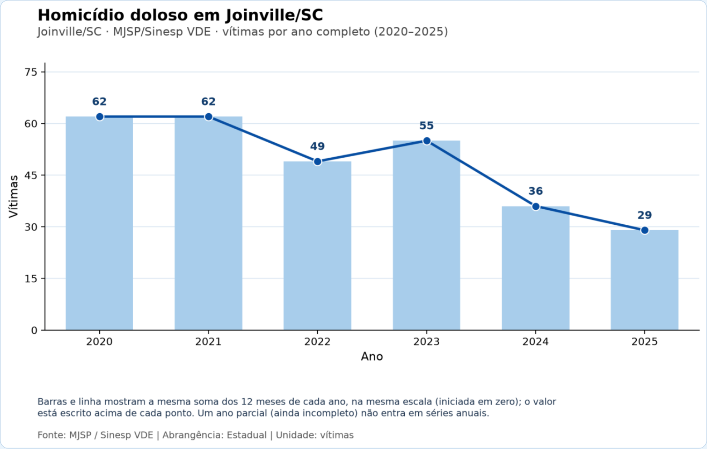
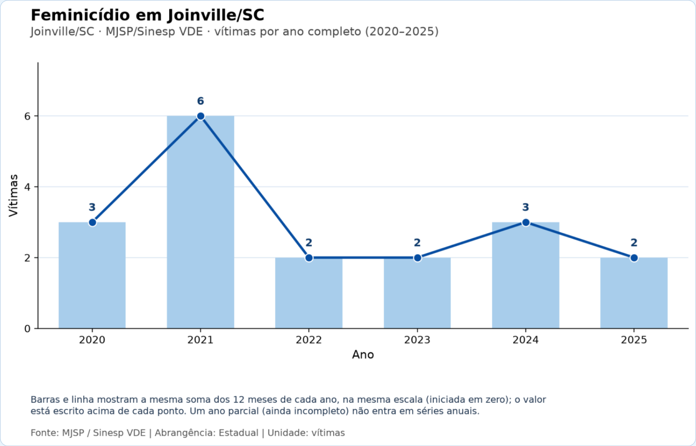
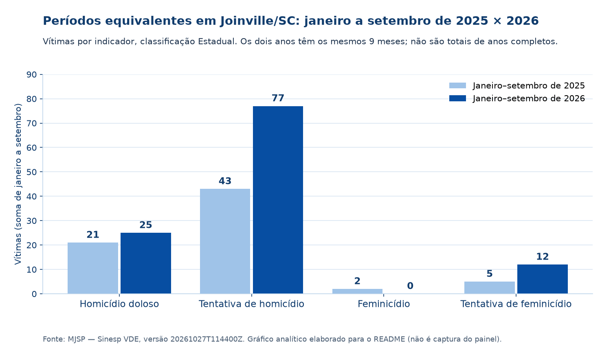
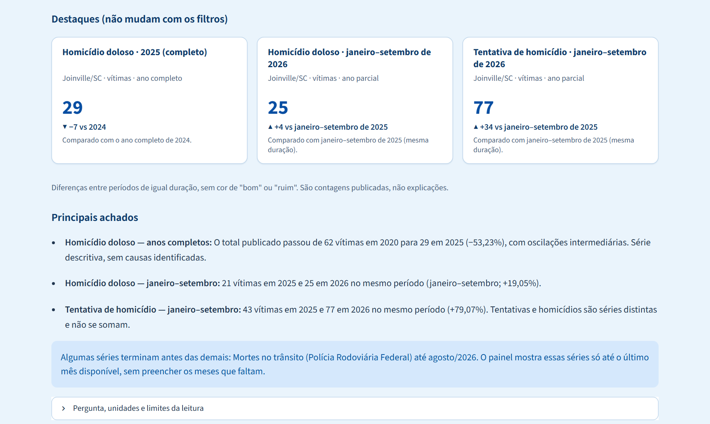
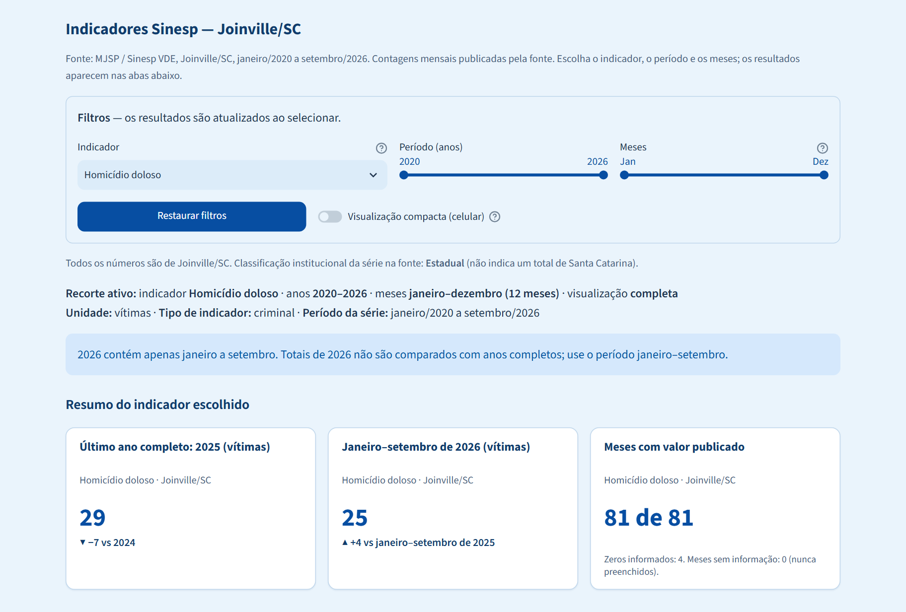
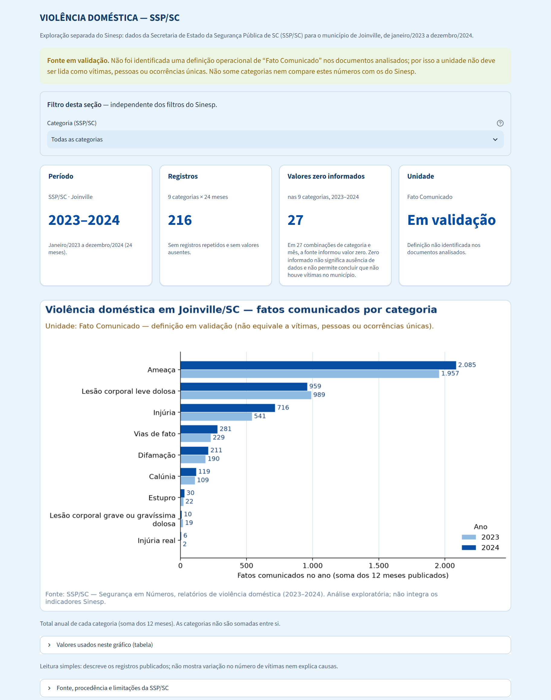
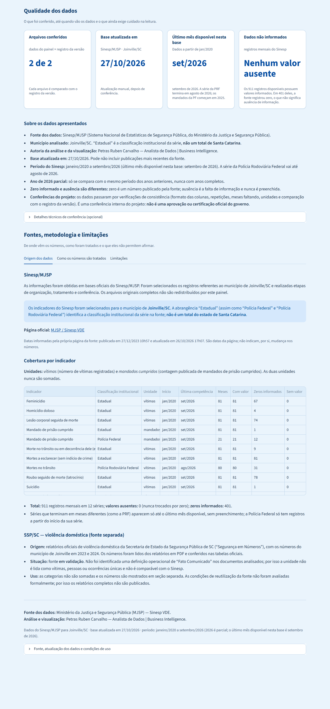

# Segurança Pública de Joinville — Visualização de Dados e Business Intelligence

**Curso:** SENAI/SC — LAB365 | Módulo 2 — Projeto Final

**Aluno:** Petras Ruben Carvalho

**Tema:** Indicadores oficiais de segurança pública de Joinville/SC

Este projeto utiliza **Python, pandas, Matplotlib e Streamlit** para organizar, conferir e apresentar dados públicos sobre a segurança de Joinville, em Santa Catarina. A análise principal utiliza os dados do **Sinesp/MJSP**, de janeiro de 2020 a setembro de 2026. Os documentos da **SSP/SC** foram examinados separadamente, pois possuem critérios e limitações diferentes.

**Aplicação Streamlit:** [endereço público existente](https://seguranca-publica-joinville-sinesp.streamlit.app/). A atualização para a versão final de página única será conferida após a publicação dos commits aprovados no GitHub. Até lá, esse endereço ainda mostra a interface anterior; as capturas deste README são da versão local.

<p align="center">
  
</p>

---

## 1. Título e resumo

**Indicadores oficiais de segurança pública de Joinville/SC: Análise do Sinesp/MJSP (2020–2026) e exame dos documentos da SSP/SC.**

Os sete arquivos anuais do Sinesp foram transformados em **911 registros mensais**, organizados em **12 séries de indicadores**, considerando também a instituição responsável pelo registro. O resultado é um painel interativo de página única, acompanhado por um programa de tratamento de dados (ETL) e um notebook de análise.

A investigação da SSP/SC reuniu **45 PDFs oficiais**. Entre eles, três documentos de violência doméstica permitiram identificar **216 registros mensais por categoria**, de 2023 a 2024. Esses números foram conferidos com os documentos originais, mas a expressão **“Fato Comunicado”** não teve seu significado operacional esclarecido nos PDFs examinados. Por isso, os resultados são apresentados de modo separado, com ressalvas.

Não foi criado um total geral de criminalidade: Indicadores com significados, unidades ou fontes diferentes **não devem ser somados**.

## 2. Problema, objetivo e importância

**Pergunta do projeto:** como os indicadores oficiais de segurança pública de Joinville evoluíram entre 2020 e 2026 e o que podemos concluir ao comparar períodos equivalentes?

O objetivo é reunir dados municipais, conferir sua origem, tratar as informações e construir gráficos de fácil compreensão. A análise compara anos completos e, para 2026, somente os meses disponíveis em cada série.

Os resultados podem ajudar cidadãos, estudantes, pesquisadores e gestores a compreender os indicadores publicados. Entretanto, **registros oficiais não representam necessariamente todos os fatos ocorridos** e, por si só, não demonstram as causas das mudanças observadas.

## 3. Escopo e resultados esperados

| Situação                                             | Dados e funcionalidades                                                                                                                                                                                                                                 |
| ------------------------------------------------------ | ------------------------------------------------------------------------------------------------------------------------------------------------------------------------------------------------------------------------------------------------------- |
| **Painel principal  <br />Fonte: Sinesp/MJSP** | Homicídio doloso, tentativa de homicídio, feminicídio, tentativa de feminicídio, lesão corporal seguida de morte, latrocínio, suicídio, mortes a esclarecer, mortes no trânsito e mandados de prisão cumpridos (11 indicadores em 12 séries). |
| **Seção separada <br />Fonte: SSP/SC**        | Violência doméstica por categoria, de 2023 a 2024; análise completa disponível localmente, com limitações de interpretação e publicação.                                                                                                      |
| **Investigação preservada**                    | Divergências em boletins de homicídio da SSP/SC e em números de furtos e roubos divulgados pela Prefeitura.                                                                                                                                          |
| **Fora do escopo da base principal**             | Furto, roubo, estupro e tráfico (não existem no Sinesp de Joinville); ocorrências por rua, bairro e horário; dados da Guarda Municipal; taxas por população; previsões; relações de causa e efeito.                                            |

A entrega acadêmica inclui **código Python, notebook, visualizações, aplicação Streamlit, documentação, histórico Git, repositório no GitHub da turma, vídeo de até três minutos e links no AVA**.

## 4. Fontes e autorização

### 4.1 Sinesp/MJSP - Fonte principal

**Origem:** [Ministério da Justiça e Segurança Pública — Sinesp VDE](https://www.gov.br/mj/pt-br/assuntos/sua-seguranca/seguranca-publica/estatistica/download/dnsp-base-de-dados).

- **Arquivos:** `bancovde-2020.xlsx` à `bancovde-2026.xlsx` (um por ano, cerca de 24 MB cada).
- **Recorte aplicado:** `uf = SC` e `municipio = JOINVILLE`.
- **Medidas:** Vítimas em `total_vitima`; mandados cumpridos em `total`.
- **Versão dos dados analisados:** `20261027T114400Z` (edição republicada pelo MJSP em 27/10/2026).
- **Cobertura:** janeiro/2020 a setembro/2026. Em relação aos dados da Polícia Rodoviária Federal - PRF, os dados vão até agosto/2026 e os mandados de prisão da Polícia Federal começam em janeiro/2025.

O painel utiliza apenas os dados agregados de Joinville, guardados em `dashboard/data_publica/`. Os grandes arquivos Excel originais **não são publicados no repositório**: o portal gov.br indica a licença geral CC BY-ND 3.0, mas não foi encontrada autorização específica para redistribuir as bases. Por isso, a publicação é limitada aos dados agregados, sempre com a atribuição da fonte.

**Arquivos da base pública (`dashboard/data_publica/`):**

| Arquivo                             | Conteúdo                                                                                                            |
| ----------------------------------- | -------------------------------------------------------------------------------------------------------------------- |
| `sinesp_joinville_mensal.csv`     | 911 registros com as colunas `ano`, `mes`, `evento`, `abrangencia` (instituição), `unidade` e `valor`. |
| `sinesp_catalogo_indicadores.csv` | Uma linha para cada uma das 12 séries, com unidade e período disponível.                                          |
| `manifesto_dados_publicos.json`   | Versão, origem, datas, regras de validação e o código SHA-256 de cada arquivo.                                   |

### 4.2 SSP/SC - Fonte complementar

**Origem:** [Secretaria de Estado da Segurança Pública de Santa Catarina - Segurança em Números](https://ssp.sc.gov.br/segurancaemnumeros/).

Foram examinados **42 boletins mensais** e **três relatórios de violência doméstica** ([1º semestre de 2023](https://ssp.sc.gov.br/wp-content/uploads/2025/06/VIOLENCIA-DOMESTICA-1o-SEMESTRE-2023.pdf), [2º semestre de 2023](https://ssp.sc.gov.br/wp-content/uploads/2025/06/VIOLENCIA-DOMESTICA-2o-SEMESTRE-2023.pdf) e [2024](https://ssp.sc.gov.br/wp-content/uploads/2025/06/VIOLENCIA-DOMESTICA-2024-SC.pdf)), totalizando **45 PDFs**. Para cada PDF foi preparado um CSV que localiza as células das tabelas; o programa usa esse CSV para encontrar o bloco de Joinville e confere cada valor diretamente no PDF, registrando o documento, a página, a tabela e a linha de origem.

Os relatórios de violência doméstica não esclarecem suficientemente o significado de **“Fato Comunicado”**, e a página da fonte informa “Todos os Direitos Reservados”, sem licença de reutilização. Por prudência, **os PDFs, os CSVs extraídos e o CSV tratado da SSP/SC permanecem somente no computador**, sem publicação no GitHub ou no Streamlit Cloud.

### 4.3 Outros dados consultados

Notícias da Prefeitura/SEPROT e um relatório da SSP/SC disponibilizado pela ALESC apresentam números divergentes para 2023: **furtos de 1.351 ou 8.865** e **roubos de 361, 669 ou 933**, conforme a fonte. Como as publicações não esclarecem todos os critérios necessários para conciliar esses valores, **eles não foram incorporados ao painel principal**.

Isso demonstra por que identificar a origem e o significado dos números é tão importante quanto construir gráficos. As fontes, as divergências e a matriz de indicadores consultados estão no [anexo de fontes complementares](documentacao/anexos/notas_fontes_complementares.md), sem integrar a base do painel.

## 5. ETL e metodologia

### 5.1 Principais cuidados adotados

- **Recorte municipal:** Considerar somente registros identificados como Joinville/SC.
- **Instituição responsável:** “Estadual”, Polícia Federal (PF) e Polícia Rodoviária Federal (PRF) indicam a origem da série, não a soma de todas as instituições. **“Estadual” não significa o total do estado de Santa Catarina.**
- **Períodos diferentes:** A maior parte das séries vai até setembro de 2026, a PRF vai até agosto de 2026, os mandados da PF começam em janeiro de 2025. Nenhum mês é preenchido artificialmente.
- **2026 incompleto:** Comparar janeiro a setembro de 2026 com janeiro a setembro de anos anteriores; para a PRF, utilizar janeiro a agosto.
- **Zero e ausência:** Existem **401 valores iguais a zero publicados pela fonte** e **nenhum valor ausente** na base atual. Zero não é a mesma coisa que falta de informação, e ausência nunca vira zero.
- **Unidades:** Vítimas e mandados cumpridos são medidas diferentes; nunca são somadas.
- **Fontes independentes:** Não misturar Sinesp com SSP/SC nem interpretar “Fato Comunicado” como número de vítimas ou de ocorrências únicas.
- **Estatísticas:** Média, mediana, desvio-padrão e análise de valores incomuns (limites de Tukey) descrevem os dados observados, sem indicar automaticamente a causa das mudanças.
- **Integridade:** o código SHA-256 funciona como uma impressão digital do arquivo. O manifesto guarda o SHA-256 dos sete XLSX e dos arquivos publicados; o ETL só aceita os arquivos que correspondem à versão aprovada.

### 5.2 Tratamento dos dados em Python

O programa principal é [`scripts/etl_joinville.py`](scripts/etl_joinville.py), um roteiro sequencial organizado em **14 etapas numeradas** e comentado linha a linha com `#`. Para tarefas específicas, ele usa funções auxiliares de `src/pipeline/`: a leitura das linhas de Joinville no XLSX (`atualizacao_dados.py` e `transform.py`), a lista oficial de indicadores e unidades (`versionamento_dados.py`) e a extração e conferência da SSP/SC (`ssp_sc.py`).

| Etapas           | O que é feito                                                                                                                  |
| ---------------- | ------------------------------------------------------------------------------------------------------------------------------- |
| **1–2**   | Importação das bibliotecas e definição das pastas.                                                                          |
| **3–4**   | Leitura dos dados oficiais de Joinville e primeira inspeção das tabelas (`head()` e `info()`).                            |
| **5–6**   | Identificação de registros repetidos (`duplicated()`) e de informações ausentes (`isna()`), sem apagar observações.   |
| **7–8**   | Padronização de datas, tipos de dados e unidades; conferência de que todas as linhas são de Joinville/SC.                   |
| **9–10**  | Organização por indicador, instituição e mês (`groupby()` e `sum()`); conferência com a base aprovada.                |
| **11–12** | Leitura e conferência dos documentos da SSP/SC (159 verificações).                                                           |
| **13–14** | Exportação para `dados/processados/etl_joinville/` (Sinesp e SSP/SC em pastas separadas) e releitura dos arquivos gravados. |

O resultado do Sinesp reconstruído pelo ETL é **idêntico** à base pública aprovada (mesmo SHA-256). **O ETL não substitui a base do dashboard**: ele grava apenas na sua própria pasta de saída. Se faltar um documento obrigatório ou se a integridade não corresponder à versão esperada, o processamento é interrompido com uma mensagem explicativa, para evitar resultados não confiáveis.

### 5.3 Análise da SSP/SC, UNION / JOIN das tabelas

A extração da violência doméstica produziu **216 valores** (9 categorias × 24 meses). Nos boletins de homicídio foram identificados outros **294 valores publicados**, com republicações que precisam ser examinadas separadamente. A conferência dos PDFs incluiu **159 verificações**, sem divergência nas células auditadas.

A organização dos dados também permitiu estudar dois procedimentos usados em análise de dados ([`src/pipeline/consolidacao.py`](src/pipeline/consolidacao.py)):

- **UNION:** Reunir tabelas de estrutura compatível com `pd.concat()`, mantendo a identificação da fonte de cada linha.
- **JOIN:** Relacionar tabelas por campos em comum com `merge()`, por exemplo, ligar cada série à descrição do indicador.

Foi possível preparar uma união candidata de **1.127 linhas** (911 do Sinesp e 216 da violência doméstica), mas ela **não foi adotada como base consolidada** porque as fontes possuem critérios diferentes e a SSP/SC ainda apresenta limitações de interpretação e reutilização.

### 5.4 Notebook de análise

O arquivo [`notebooks/analise_seguranca_publica_joinville.ipynb`](notebooks/analise_seguranca_publica_joinville.ipynb) reúne **16 etapas didáticas**: leitura, inspeção, tratamento, verificações de duplicidade e ausência, estatísticas, comparações anuais e de períodos equivalentes, identificação de valores incomuns e gráficos. A análise da SSP/SC é apresentada separadamente.

O notebook foi **salvo com os resultados** (tabelas, textos e gráficos) da execução completa feita no computador do autor, com os arquivos originais. Assim, a análise pode ser lida diretamente no GitHub ou no VS Code, **sem executar nada e sem abrir o Streamlit**.

Ao executá-lo novamente a partir de uma cópia do GitHub, as etapas 1, 2, 4 a 11 e 16 funcionam somente com a base pública de `dashboard/data_publica/`. A etapa 3 (XLSX de 2026) e as etapas 12 a 15 (SSP/SC) dependem dos arquivos originais: sem eles, exibem um aviso, e a SSP/SC mostra a figura-resumo já publicada, sem estimar nenhum valor.

## 6. Bibliotecas e tecnologias

| Ferramenta                   | Utilização                                            |
| ---------------------------- | ------------------------------------------------------- |
| **Python 3.12**        | Programação das etapas do projeto.                    |
| **VS Code e Jupyter**  | Desenvolvimento e execução do notebook.               |
| **pandas**             | Leitura, limpeza, organização e análise das tabelas. |
| **Matplotlib**         | Construção dos gráficos.                             |
| **Streamlit 1.66**     | Painel interativo para apresentação dos resultados.   |
| **lxml**               | Leitura do conteúdo das planilhas Excel do Sinesp.     |
| **pdfplumber e pypdf** | Leitura e conferência dos PDFs da SSP/SC.              |
| **ipykernel**          | Execução do notebook no VS Code.                      |
| **Git e GitHub**       | Controle de versão e publicação do projeto.          |

As dependências estão listadas em [`requirements.txt`](requirements.txt). O ambiente local usa **Python 3.12.14**, e o Streamlit Cloud foi configurado com Python 3.12.

## 7. Resultados encontrados

### 7.1 Sinesp/MJSP - Resultados validados

A base final disponível nesta versão contém **911 registros**, distribuídos em **12 séries**, sem valores ausentes e com **401 zeros informados pela fonte**. Em relação à versão anterior de agosto de 2026 (900 registros), foram acrescentados dados de setembro de 2026 sem alterar os valores históricos aprovados. Cada registro é o valor de **um mês de uma série** (por exemplo, as vítimas de homicídio doloso em março de 2024); por isso, **911 registros não significam 911 crimes**.

Os resultados de destaque são apresentados em **duas análises separadas**, porque respondem a perguntas diferentes. Todos os valores abaixo são de **vítimas**, na classificação **Estadual**.

#### Análise histórica — anos completos (2020 a 2025)

Compara anos com os **12 meses publicados**. Serve para observar a evolução ao longo do tempo.

| Indicador                 | 2020 | 2025 | Diferença (2025 − 2020) |
| ------------------------- | ---: | ---: | ------------------------: |
| Homicídio doloso         |   62 |   29 |                      −33 |
| Tentativa de homicídio   |   98 |   53 |                      −45 |
| Feminicídio              |    3 |    2 |                       −1 |
| Tentativa de feminicídio |   10 |    9 |                       −1 |

**Como ler:** em homicídio doloso, o total de vítimas passou de **62 em 2020 para 29 em 2025**. As duas contagens têm 12 meses cada, por isso a comparação é direta. Os anos intermediários oscilaram (por exemplo, 49 em 2022 e 55 em 2023), como mostra o gráfico do painel abaixo.

<p align="center">
  
</p>

<p align="center">
  
</p>

*Capturas do aplicativo Streamlit (aba "Evolução"): somente anos completos; 2026 não aparece porque ainda está incompleto.*

#### Comparação de períodos equivalentes — janeiro a setembro de 2025 × 2026

2026 só tem dados **até setembro**. Por isso, ele é comparado apenas com **os mesmos nove meses de 2025**, e não com o ano de 2025 inteiro. Esses valores **não são totais anuais**.

| Indicador                 | Jan.–set. de 2025 | Jan.–set. de 2026 | Diferença |
| ------------------------- | -----------------: | -----------------: | ---------: |
| Homicídio doloso         |                 21 |                 25 |         +4 |
| Tentativa de homicídio   |                 43 |                 77 |        +34 |
| Feminicídio              |                  2 |                  0 |        −2 |
| Tentativa de feminicídio |                  5 |                 12 |         +7 |

**Como ler:** de janeiro a setembro, o homicídio doloso passou de **21 vítimas em 2025 para 25 em 2026**, e a tentativa de homicídio, de **43 para 77**. Comparar os 29 homicídios de 2025 inteiro com os 25 dos nove primeiros meses de 2026 seria errado, porque os períodos têm durações diferentes. As diferenças descrevem os registros publicados e não indicam, sozinhas, as suas causas.

<p align="center">
  
</p>

*Gráfico analítico elaborado para este README a partir da base aprovada (não é captura do aplicativo). No painel, a mesma comparação fica na aba "Comparações", em "Períodos equivalentes".*

<details>
<summary><strong>Consultar os totais anuais de todos os indicadores</strong></summary>

**2026 é parcial:** janeiro–setembro na maioria das séries; janeiro–agosto na PRF. “—” significa que não há cobertura para o período, e não zero.

| Indicador                                   | 2020 | 2021 | 2022 | 2023 |  2024 |  2025 | 2026 parcial |
| ------------------------------------------- | ---: | ---: | ---: | ---: | ----: | ----: | -----------: |
| Feminicídio                                |    3 |    6 |    2 |    2 |     3 |     2 |            0 |
| Homicídio doloso                           |   62 |   62 |   49 |   55 |    36 |    29 |           25 |
| Lesão corporal seguida de morte            |    0 |    2 |    3 |    1 |     1 |     0 |            1 |
| Mandados de prisão cumpridos               |  612 |  790 |  884 |  980 | 1.035 | 1.248 |          936 |
| Mortes no trânsito ou em decorrência dele |   22 |   21 |   33 |   26 |    34 |    20 |           14 |
| Mortes a esclarecer                         |    0 |    0 |    0 |    0 |     0 |     0 |            0 |
| Mortes no trânsito - PRF                   |   10 |   11 |   13 |    7 |     8 |    13 |            6 |
| Latrocínio                                 |    0 |    1 |    3 |    0 |     0 |     0 |            0 |
| Suicídio                                   |   43 |   52 |   67 |   44 |    48 |    39 |           31 |
| Tentativa de feminicídio                   |   10 |    4 |    7 |    7 |    10 |     9 |           12 |
| Tentativa de homicídio                     |   98 |   96 |  103 |  101 |    82 |    53 |           77 |
| Mandados de prisão cumpridos - PF          |   — |   — |   — |   — |    — |     8 |            8 |

**Atenção:** vítimas, mandados cumpridos e classificações institucionais não formam um total geral.

</details>

As [tabelas completas por ano e por períodos equivalentes, com estatísticas mensais](documentacao/anexos/tabelas_resultados_sinesp.md), estão em anexo.

Além das somas, foram calculadas estatísticas mensais. Como exemplo, o homicídio doloso apresentou **318 vítimas ao longo dos 81 meses analisados**, média de **3,93 por mês** e mediana de **3**. A estatística de valores incomuns identifica meses que merecem observação, mas não explica por que tiveram números mais altos ou mais baixos.

### 7.2 SSP/SC - Violência doméstica

Os três relatórios consultados contêm valores de janeiro de 2023 a dezembro de 2024. Foram organizados **216 registros mensais**, distribuídos por nove categorias, com **27 zeros publicados** e nenhum valor ausente. A unidade usada nos relatórios é **“Fato Comunicado”**, cujo significado preciso não foi esclarecido nos documentos examinados.

| Categoria                                   |  2023 |  2024 | Diferença |
| ------------------------------------------- | ----: | ----: | ---------: |
| Ameaça                                     | 1.957 | 2.085 |       +128 |
| Lesão corporal leve dolosa                 |   989 |   959 |       −30 |
| Injúria                                    |   541 |   716 |       +175 |
| Vias de fato                                |   229 |   281 |        +52 |
| Difamação                                 |   190 |   211 |        +21 |
| Calúnia                                    |   109 |   119 |        +10 |
| Estupro                                     |    22 |    30 |         +8 |
| Lesão corporal grave ou gravíssima dolosa |    19 |    10 |        −9 |
| Injúria real                               |     2 |     6 |         +4 |

É possível comparar **cada categoria consigo mesma** entre 2023 e 2024. Não é correto somar as categorias como se representassem pessoas ou ocorrências únicas, nem juntar esses números aos indicadores do Sinesp.

### 7.3 SSP/SC - Republicações dos boletins de homicídio

Os boletins apresentam valores diferentes em edições distintas. Em **58 grupos de republicação**, **41 possuem versões divergentes ou questões de cabeçalho ainda não esclarecidas**. Nenhuma versão foi escolhida arbitrariamente como definitiva.

| Ano  | Edições | Versões publicadas (SSP/SC) | Sinesp, homicídio doloso |
| ---- | --------: | ---------------------------- | ------------------------: |
| 2020 |        11 | 65 ou 66                     |                        62 |
| 2021 |        24 | 62 ou 68                     |                        62 |
| 2022 |        35 | 49 ou 51                     |                        49 |
| 2023 |        31 | 56 ou 58                     |                        55 |
| 2024 |        18 | 36 ou 37                     |                        36 |
| 2025 |         7 | 32                           |                        29 |

São nomenclaturas e processos de publicação diferentes (“vítimas de homicídio” na SSP/SC; “homicídio doloso” no Sinesp): não se deve somá-las nem presumir que medem exatamente o mesmo fenômeno.

## 8. Discussão e conclusão

Os dados do Sinesp mostram uma redução de **62 vítimas de homicídio doloso em 2020 para 29 em 2025**, considerando anos completos. Já entre janeiro e setembro, o indicador passou de **21 em 2025 para 25 em 2026**, o que demonstra a importância de analisar o intervalo escolhido.

As tentativas de homicídio também merecem atenção: **43 no período janeiro–setembro de 2025 e 77 no mesmo período de 2026**. Essas diferenças descrevem os registros disponíveis, sem demonstrar suas causas.

Na SSP/SC, sete das nove categorias de violência doméstica apresentaram valores maiores em 2024 do que em 2023. Entretanto, a falta de definição operacional de “Fato Comunicado” impede interpretações além da comparação dos valores publicados por categoria.

## 9. Aplicação profissional

O projeto exercita uma atividade importante do analista de dados: Transformar arquivos públicos em informações compreensíveis, **sem perder a origem, as unidades e as limitações de cada número**.

Foram aplicadas práticas de leitura e tratamento de bases, análise exploratória, construção de indicadores, visualização de dados, conferência de integridade e documentação. As divergências entre fontes mostram que, antes de construir um gráfico, é necessário verificar **o que cada registro realmente representa**.

## 10. Aplicação Streamlit

O Streamlit reúne a análise em **uma única página**, com a bandeira de Joinville no cabeçalho, cores inspiradas nela, fundo azul-claro, cartões brancos e gráficos com barras azul-claras e linha azul-escura. Um índice no topo leva a cada seção. O painel lê somente a base aprovada de `dashboard/data_publica/`: não executa o ETL e não baixa dados da internet. A descrição e as capturas abaixo são da **versão local** (ver o final desta seção).

| Seção                                      | O que o usuário encontra                                                                                                                                                                                                                    |
| -------------------------------------------- | -------------------------------------------------------------------------------------------------------------------------------------------------------------------------------------------------------------------------------------------- |
| **Apresentação**                     | Período, quantidade de registros e de séries, último mês disponível, três destaques fixos (homicídio doloso e tentativa de homicídio) e os principais achados.                                                                                                                     |
| **Indicadores Sinesp**                 | Filtros, cartões com os totais do indicador escolhido e cinco abas: Evolução, Comparações, Meses e tendência, Estatísticas e meses incomuns, Indicadores e como interpretar. Cada gráfico tem uma tabela com os números desenhados. |
| **Violência doméstica - SSP/SC**     | Fonte separada, em validação. Na execução local: filtro **Categoria (SSP/SC)**, cartões e gráfico mensal; no Streamlit Cloud: aviso e figura-resumo.                                                                             |
| **Qualidade dos dados**                | Conferência dos arquivos, período disponível e explicação sobre zeros e ausências.                                                                                                                                                     |
| **Fontes, metodologia e limitações** | Origem dos números, método de tratamento e cuidados de interpretação.                                                                                                                                                                    |

<p align="center">
  
</p>

<p align="center">
  
</p>

Os filtros do Sinesp são **Indicador**, **Período (anos)** e **Meses**, com o botão **Restaurar filtros** e a chave **Visualização compacta (celular)**. A escolha da classificação institucional só aparece em **Mandado de prisão cumprido**, que tem duas séries (Estadual e Polícia Federal). Um bloco recolhível mostra ainda quatro gráficos de referência fixos dos indicadores principais (homicídio doloso, tentativa de homicídio, feminicídio e tentativa de feminicídio), que não mudam com os filtros.

**Acesso à SSP/SC:** a seção detalhada de violência doméstica, com seleção de categoria, números e gráfico, depende do arquivo tratado que permanece **somente no computador**. No **Streamlit Cloud**, a aplicação apresenta a limitação e uma figura-resumo, sem disponibilizar o CSV tratado. A captura abaixo é da execução local.

<p align="center">
  
</p>

<p align="center">
  
</p>

**Versão local e versão pública:**

- **Versão local (final):** executada com `.\.venv\Scripts\python.exe -m streamlit run scripts/painel_streamlit.py` e aberta em `http://localhost:8501`. É a interface de página única descrita e capturada nesta seção.
- **Versão pública:** [endereço no Streamlit Community Cloud](https://seguranca-publica-joinville-sinesp.streamlit.app/). Em 29/10/2026, ainda mostrava a interface anterior, com três páginas (Projeto, Indicadores Sinesp e Qualidade e metodologia), porque o GitHub ainda não recebeu todos os commits locais. A atualização para a versão de página única será conferida após a publicação dos commits aprovados.

## 11. Como executar

Abra o **Prompt de Comando (CMD)** na pasta principal do projeto.

```bat
:: 1. Copiar o projeto do GitHub e entrar na pasta
git clone https://github.com/petrascarvalho/analise_seguranca_publica_joinville_SC.git
cd analise_seguranca_publica_joinville_SC

:: 2. Criar o ambiente virtual e instalar as bibliotecas
python -m venv .venv
.\.venv\Scripts\python.exe -m pip install -r requirements.txt

:: 3. Abrir o painel interativo no navegador (funciona sem os arquivos originais)
.\.venv\Scripts\python.exe -m streamlit run scripts/painel_streamlit.py

:: 4. Executar o ETL (exige os arquivos originais; ver abaixo)
.\.venv\Scripts\python.exe scripts\etl_joinville.py
```

**Notebook:** abra `notebooks/analise_seguranca_publica_joinville.ipynb` no VS Code. Os resultados já aparecem salvos. Para executar de novo, selecione o interpretador Python do ambiente `.venv` e use *Run All*.

**Arquivos originais (fora do GitHub):** para reproduzir o ETL completo, baixe os sete `bancovde-ANO.xlsx` no [catálogo do MJSP](https://www.gov.br/mj/pt-br/assuntos/sua-seguranca/seguranca-publica/estatistica/download/dnsp-base-de-dados) e coloque-os em `dados/brutos/sinesp/` (o ETL procura também nas subpastas e só usa a edição cujo SHA-256 está no manifesto). A parte da SSP/SC exige os 45 PDFs da página [Segurança em Números](https://ssp.sc.gov.br/segurancaemnumeros/) em `dados/brutos/ssp_sc/pdfs/` e os 45 CSVs extraídos em `dados/brutos/ssp_sc/csv_extraidos/`, que permanecem apenas no computador do autor. **O painel e o notebook funcionam sem esses arquivos**, pois usam a base Sinesp já aprovada.

**Opcional:** `.\.venv\Scripts\python.exe -m src.pipeline.consolidacao` grava a Sinesp no esquema comum da UNION, e `.\.venv\Scripts\python.exe -m src.pipeline.atualizacao_dados verificar` consulta a fonte oficial e apenas grava um relatório na pasta local `atualizacao/`, sem alterar os dados do painel.

## 12. Estrutura de pastas

```text
Seguranca Publica Joinville/
│
├── README.md
├── requirements.txt
├── .gitignore
│
├── scripts/
│   ├── etl_joinville.py                 ← programa 1: ETL em 14 etapas
│   └── painel_streamlit.py              ← programa 2: painel Streamlit
│
├── notebooks/
│   └── analise_seguranca_publica_joinville.ipynb
│
├── dashboard/                           ← partes do painel
│   ├── pages/
│   │   ├── home.py                      ← apresentação e destaques
│   │   ├── sinesp.py                    ← filtros, gráficos e tabelas do Sinesp
│   │   ├── violencia_domestica.py       ← seção separada da SSP/SC
│   │   └── quality.py                   ← qualidade dos dados e metodologia
│   ├── data_publica/                    ← base Sinesp aprovada (usada pelo painel)
│   │   ├── sinesp_joinville_mensal.csv
│   │   ├── sinesp_catalogo_indicadores.csv
│   │   └── manifesto_dados_publicos.json
│   ├── assets/
│   │   └── bandeira_joinville.svg
│   ├── calculos.py                      ← somas, comparações e estatísticas
│   ├── graficos.py                      ← gráficos em Matplotlib
│   ├── ui.py                            ← estilo, cabeçalho e cartões
│   ├── dados_publicos.py                ← leitura e conferência da base aprovada
│   ├── dados_ssp.py                     ← leitura local da SSP/SC
│   └── formatacao.py                    ← números e meses no padrão brasileiro
│
├── src/
│   └── pipeline/                        ← funções auxiliares usadas pelo ETL
│       ├── atualizacao_dados.py         ← leitura do XLSX e atualização controlada
│       ├── transform.py                 ← leitura rápida das linhas de Joinville
│       ├── versionamento_dados.py       ← indicadores, unidades e cobertura
│       ├── fontes_oficiais.py           ← consulta às páginas oficiais
│       ├── ssp_sc.py                    ← extração e conferência da SSP/SC
│       ├── consolidacao.py              ← estudo de UNION e JOIN
│       └── utils.py
│
├── documentacao/
│   ├── anexos/
│   │   ├── tabelas_resultados_sinesp.md
│   │   └── notas_fontes_complementares.md
│   └── graficos/
│       ├── analises/
│       │   └── 07-sspsc_violencia_domestica_2023_2024.png
│       └── painel/
│           ├── 01_visao_geral_pagina_unica.png
│           ├── 02_destaques_e_achados.png
│           ├── 03_filtros_e_resumo_sinesp.png
│           ├── 04_grafico_homicidio_doloso_anual.png
│           ├── 05_grafico_feminicidio_anual.png
│           ├── 06_violencia_domestica_ssp_sc.png
│           ├── 07_qualidade_e_metodologia.png
│           └── 08_grafico_analitico_jan_set_2025_2026.png   ← gráfico analítico (não é captura)
│
├── .streamlit/
│   └── config.toml                      ← tema do painel
├── .vscode/
│   └── settings.json                    ← interpretador da .venv e pasta do notebook
│
└── dados/                               ← somente no computador (fora do GitHub)
    ├── brutos/
    │   ├── sinesp/                      ← 7 XLSX oficiais (2020–2026)
    │   └── ssp_sc/                      ← 45 PDFs e 45 CSVs extraídos
    └── processados/
        └── etl_joinville/               ← criada pelo ETL ao ser executado (sinesp/ e ssp_sc/)
```

As pastas `dashboard/` e `src/` também têm um arquivo `__init__.py`, que permite importar os módulos. A pasta `src/` permanece porque contém funções utilizadas pelo ETL e pelo notebook. A pasta `dados/` **não é publicada**: os originais são grandes e não têm autorização confirmada de redistribuição, e a base Sinesp tratada já está em `dashboard/data_publica/`.

## 13. Limitações e melhorias futuras

- **2026 é parcial:** os resultados só podem ser comparados com o mesmo intervalo de outros anos.
- **Dados administrativos:** não registram obrigatoriamente todos os fatos e não demonstram causas ou efeitos de políticas públicas.
- **Sem detalhamento territorial:** não há base suficiente, neste escopo, para análises confiáveis por rua, bairro ou horário, nem para taxas por população.
- **Unidades diferentes:** vítimas, mandados e fatos comunicados não podem ser somados.
- **SSP/SC:** definição de “Fato Comunicado”, divergências dos boletins e condições de reutilização exigem esclarecimentos adicionais.
- **Revisões oficiais:** os valores podem ser republicados; qualquer atualização exige nova conferência.

Como continuidade, o projeto poderá incorporar novos indicadores apenas quando houver fontes municipais compatíveis, com definições, períodos e condições de reutilização esclarecidos.

## 14. Créditos e referências

**Autor:** Petras Ruben Carvalho — Analista de Dados | Business Intelligence.

**Fontes consultadas:**

- [Ministério da Justiça e Segurança Pública - Sinesp VDE](https://www.gov.br/mj/pt-br/assuntos/sua-seguranca/seguranca-publica/estatistica/dados-nacionais-1/base-de-dados-e-notas-metodologicas-dos-gestores-estaduais-sinesp-vde-2022-e-2023), base de dados e notas metodológicas.
- [Secretaria de Estado da Segurança Pública de Santa Catarina - Segurança em Números](https://ssp.sc.gov.br/segurancaemnumeros/).
- [Prefeitura de Joinville](https://www.joinville.sc.gov.br/), para consulta complementar e identificação de divergências.

As cores do painel (azul `#074EA2`, fundo `#EAF4FC`, cartões `#FFFFFF`) foram **inspiradas na bandeira de Joinville**; não representam uma paleta oficial definida pela Prefeitura.

## 15. Links de entrega

- **GitHub pessoal:** [Análise da Segurança Pública de Joinville](https://github.com/petrascarvalho/analise_seguranca_publica_joinville_SC).
- **Streamlit Cloud:** [Abrir o painel](https://seguranca-publica-joinville-sinesp.streamlit.app/). A atualização da aplicação publicada permanece pendente de conferência após o push.
- **Google Drive:** [Pasta de entrega](https://drive.google.com/drive/folders/1C14z1f0nRCzVbS321L3e9TDmocGinPfu?usp=sharing).
- **Repositório oficial da turma:** [Projeto Final — Petras Ruben Carvalho](https://github.com/Visualizacao-Dados-BI-T1/Projeto_ZP/tree/main/Projetos/Projeto_Final_do_Curso/Petras%20Ruben%20Carvalho) (repositório privado: acesso restrito aos participantes da turma).
- **LinkedIn:** [Perfil profissional](https://www.linkedin.com/in/petrasrubencarvalho/).
- **Vídeo:** pendente de produção e publicação.

## 16. Conclusões sustentadas pelas análises

O projeto organizou **911 registros mensais de 12 séries do Sinesp**, com fonte, período e unidade identificados, mantendo os valores iguais a zero e sem transformar ausência em zero. O ETL reconstrói, a partir dos XLSX oficiais, exatamente a base publicada, e a análise permitiu comparar anos completos e períodos equivalentes de forma correta.

Também demonstrou que **disponibilidade de dados não significa ausência de dúvidas metodológicas**: os documentos da SSP/SC permitem examinar a violência doméstica de 2023 e 2024, mas não esclarecem totalmente a unidade utilizada, e os boletins de homicídio contêm republicações divergentes.

A principal contribuição é disponibilizar um processo de análise **reproduzível, transparente e compreensível**, apresentando os números oficiais de Joinville sem misturar fontes, unidades ou períodos incompatíveis.

---

Projeto desenvolvido por **Petras Ruben Carvalho** — SENAI/SC LAB365, outubro de 2026.
