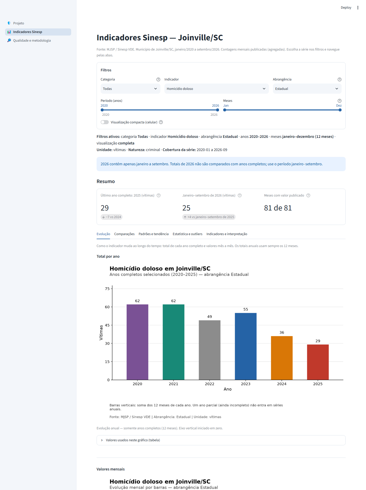
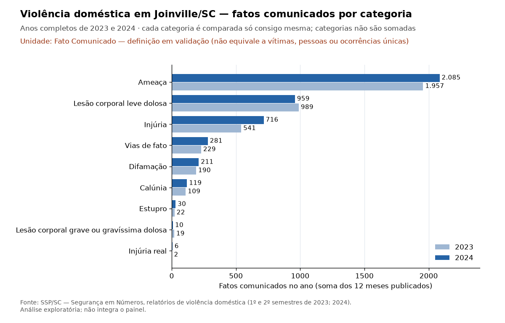

# Segurança Pública de Joinville — Visualização de Dados e Business Intelligence

**Curso:** SENAI/SC — LAB365 | Módulo 2 — Semana 13
**Aluno:** Petras Ruben Carvalho
**Projeto:** Indicadores oficiais de segurança pública de Joinville/SC

Fonte: Sinesp/MJSP (janeiro/2020 a setembro/2026) e acervo SSP/SC

Este repositório reúne a obtenção, o tratamento, a auditoria, a análise e a visualização de dados oficiais de segurança pública de **Joinville/SC**. Há duas fontes oficiais, com papéis diferentes:

- **Sinesp/MJSP** — produto analítico **validado**: é a fonte única do painel Streamlit (911 observações mensais, 12 séries).
- **SSP/SC** — **acervo oficial de Joinville preservado e em validação**: 45 boletins e relatórios em PDF, com a violência doméstica auditada mês a mês. Ainda **não** aparece no painel.

| Parte                                       | Onde está                                                                                                    | O que faz                                                                                           |
| ------------------------------------------- | ------------------------------------------------------------------------------------------------------------- | --------------------------------------------------------------------------------------------------- |
| **ETL** (script principal 1)          | [`scripts/etl_sinesp.py`](scripts/etl_sinesp.py)                                                             | Lê os XLSX oficiais do Sinesp, trata, valida, analisa e exporta, em 18 etapas comentadas           |
| **Painel** (script principal 2)       | [`scripts/painel_streamlit.py`](scripts/painel_streamlit.py)                                                 | Dashboard de página única: apresentação, indicadores Sinesp, violência doméstica SSP/SC (separada) e qualidade e metodologia |
| **Notebook**                          | [`notebooks/analise_seguranca_publica_joinville.ipynb`](notebooks/analise_seguranca_publica_joinville.ipynb) | Roteiro didático Sinesp e exploração separada SSP/SC                                             |
| **Acervo SSP/SC** (módulo auxiliar)  | [`src/pipeline/ssp_sc.py`](src/pipeline/ssp_sc.py)                                                           | Inventário dos PDFs, extração validada, auditoria da violência doméstica e das republicações |
| **Consolidação** (módulo auxiliar) | [`src/pipeline/consolidacao.py`](src/pipeline/consolidacao.py)                                               | Esquema comum, UNION auditável (`pd.concat`) e matriz de compatibilidade                         |

**Aplicação publicada:** [https://seguranca-publica-joinville-sinesp.streamlit.app/](https://seguranca-publica-joinville-sinesp.streamlit.app/)



---

## 1. Título e resumo

**Indicadores oficiais de segurança pública de Joinville/SC: análise do Sinesp/MJSP (2020–2026) e auditoria do acervo SSP/SC.**

Com Python, Pandas e Matplotlib, os arquivos anuais do Sinesp viram **911 observações** mensais de **12 séries** (indicador × abrangência), de janeiro/2020 a setembro/2026, publicadas num painel Streamlit. Cada série mantém sua unidade (vítimas ou mandados cumpridos), sua abrangência (Estadual, Polícia Federal ou Polícia Rodoviária Federal) e sua cobertura. Em paralelo, os 45 documentos da SSP/SC foram inventariados e auditados: a violência doméstica de Joinville (216 observações, 2023–2024) está extraída e conferida, mas para a unidade publicada, "Fato Comunicado", não foi identificada uma definição operacional nos documentos analisados; os homicídios dos boletins mensais têm versões divergentes entre edições. Nenhum total geral de criminalidade é calculado: indicadores, unidades, abrangências e fontes diferentes nunca são somados.

## 2. Problema, objetivo e importância

**Pergunta analítica:** como evoluíram, desde janeiro/2020, os indicadores oficiais de segurança pública de Joinville/SC, e o que a comparação entre períodos equivalentes permite — e não permite — afirmar?

**Objetivo:** produzir uma análise municipal reproduzível, com origem auditável, estatísticas adequadas a contagens mensais, comparações justas entre períodos de mesma duração e um registro honesto do que ainda não pode ser publicado.

**Importância:** estudantes, cidadãos, pesquisadores e gestores podem consultar os números com fonte, unidade e limites explícitos. São registros administrativos: não medem toda a criminalidade e não demonstram efeitos de políticas públicas.

## 3. Escopo e resultados esperados

| Situação                            | Conteúdo                                                                                                                                                                                                                                                |
| ------------------------------------- | -------------------------------------------------------------------------------------------------------------------------------------------------------------------------------------------------------------------------------------------------------- |
| **No painel (validado)**        | Sinesp/MJSP: homicídio doloso e tentativa, feminicídio e tentativa, lesão corporal seguida de morte, latrocínio, suicídio, mortes a esclarecer, mortes no trânsito (Estadual e PRF), mandados de prisão cumpridos (Estadual e Polícia Federal)   |
| **Preservado e em validação** | SSP/SC: violência doméstica mensal (9 categorias, 2023–2024) e vítimas de homicídio publicadas nos boletins mensais (2020–2026)                                                                                                                    |
| **Histórico preservado**       | Prefeitura/SEPROT (furtos e roubos 2023–2025, valores divergentes entre notícias) e o trabalho anterior da SSP/SC no painel (página removida; último commit com ela: `bad9723`), recuperáveis no Git e no backup externo da Etapa 26 (seção 12) |
| **Fora do escopo**              | Furtos, roubos em geral, estupro e tráfico no Sinesp (não existem nos arquivos de Joinville), atendimentos da Guarda Municipal, taxas populacionais, dados por bairro ou horário, previsões e inferência causal                                     |

Para o painel, o Sinesp/MJSP continua sendo a **fonte única**: a SSP/SC e Prefeitura/SEPROT ficam fora do escopo do painel até que a validação permita publicá-las.

**Requisitos da atividade (enunciado):** repositório individual com histórico e README completo; ETL em Python reproduzível e documentado; EDA, estatísticas e visualizações fundamentadas; aplicação Streamlit publicada no Streamlit Community Cloud; fontes, licenças e proteção de dados; publicação no repositório da turma; vídeo de até três minutos; envio dos links no AVA até **30/10/2026, 22h (Brasília)**. O planejamento no Trello foi **dispensado por orientação do professor**.

## 4. Fontes e autorização

### 4.1 Sinesp/MJSP (validado)

| Item              | Descrição                                                                                                                                                                                                                                                |
| ----------------- | ---------------------------------------------------------------------------------------------------------------------------------------------------------------------------------------------------------------------------------------------------------- |
| Fonte             | [Sinesp VDE / MJSP](https://www.gov.br/mj/pt-br/assuntos/sua-seguranca/seguranca-publica/estatistica/dados-nacionais-1/base-de-dados-e-notas-metodologicas-dos-gestores-estaduais-sinesp-vde-2022-e-2023) — base nacional enviada pelos gestores estaduais |
| Arquivos          | `bancovde-2020.xlsx` a `bancovde-2026.xlsx` (um por ano, 14 colunas, ~24 MB cada); download: `.../dnsp-base-de-dados/bancovde-ANO.xlsx/@@download/file`                                                                                              |
| Recorte           | `uf = SC` e `municipio = JOINVILLE` (filtro exato)                                                                                                                                                                                                     |
| Medidas           | vítimas em `total_vitima`; mandados cumpridos em `total`                                                                                                                                                                                              |
| Versão dos dados | `20261027T114400Z` (SHA-256 de cada XLSX e dos arquivos derivados no manifesto)                                                                                                                                                                          |

Duas edições oficiais estão guardadas em `dados/brutos/sinesp/`: `oficial_20261027/` (republicada em 27/10/2026, usada pela base aprovada) e a edição auditada em agosto/2026 (raiz da pasta e `pendente_validacao_origem/`). A procedência de 2020–2022 foi conferida contra os arquivos oficiais ([evidência](documentacao/auditoria/sinesp_origem_2020_2022.csv)): 2021 e 2022 têm hash igual; em 2020 o hash difere, mas todas as linhas e células são idênticas. O MJSP informa que o valor zero significa ausência de ocorrência.

**Condições de reutilização (consulta de 27/10/2026):** o catálogo `dados.mj.gov.br` seria "Creative Commons Atribuição", segundo o responsável, mas esse registro **não pôde ser confirmado** (o domínio não resolveu); o rodapé do portal gov.br declara CC BY-ND 3.0, licença geral do site. Nenhuma proibição específica foi encontrada, mas também não há autorização específica explícita (avaliação técnica, não parecer jurídico). Por prudência, o repositório publica só arquivos **mínimos, agregados e derivados** (`dashboard/data_publica/`), sempre com atribuição; os XLSX ficam fora do Git.

### 4.2 SSP/SC (preservado e em validação)

| Item       | Descrição                                                                                                                                                                       |
| ---------- | --------------------------------------------------------------------------------------------------------------------------------------------------------------------------------- |
| Fonte      | Secretaria de Estado da Segurança Pública de SC — [Segurança em Números](https://ssp.sc.gov.br/segurancaemnumeros/)                                                           |
| Documentos | **45 PDFs oficiais**: 42 boletins mensais (2023–2026) e 3 relatórios de violência doméstica (1º e 2º semestres de 2023 e ano de 2024), com todos os municípios de SC |
| Derivados  | 45 CSVs extraídos dos PDFs (um por documento). O CSV não substitui o PDF: serve para localizar página, tabela e linha de cada valor                                            |
| Joinville  | violência doméstica por "Município do Fato" e "Fato Comunicado"; vítimas de homicídio em totais anuais e acumulados do ano                                                   |

Os PDFs ficam em `dados/brutos/ssp_sc/` (fora do Git) e são guardados inteiros, inclusive com os demais municípios, para comprovar a extração. As condições de reutilização da SSP/SC não foram avaliadas formalmente; por isso os arquivos integrais ficam fora do Git. O README e a figura exploratória mostram agregados municipais com atribuição e ressalvas; a confirmação das condições de reutilização permanece pendente.

**Procedência dos três relatórios de violência doméstica (conferida em 28/10/2026).** São os arquivos [1º semestre de 2023](https://ssp.sc.gov.br/wp-content/uploads/2025/06/VIOLENCIA-DOMESTICA-1o-SEMESTRE-2023.pdf), [2º semestre de 2023](https://ssp.sc.gov.br/wp-content/uploads/2025/06/VIOLENCIA-DOMESTICA-2o-SEMESTRE-2023.pdf) e [ano de 2024](https://ssp.sc.gov.br/wp-content/uploads/2025/06/VIOLENCIA-DOMESTICA-2024-SC.pdf), listados na página oficial [Segurança em Números](https://ssp.sc.gov.br/segurancaemnumeros/), elaborada pela Gerência de Estatística e Análise Criminal da Diretoria de Informação e Inteligência da SSP/SC. Cada PDF tem SHA-256 registrado em `documentacao/auditoria/ssp_sc_acervo_sha256.csv`. São tabelas exportadas do Excel, sem nota metodológica, sem definição de “Fato Comunicado” e sem licença; a página da fonte também não traz licença ou termos de reutilização, apenas o rodapé “Copyright © 2023 Todos os Direitos Reservados — Governo de Santa Catarina”, que não especifica condições de uso. Uma varredura dos três PDFs não encontrou CPF, e-mail nem telefone: há apenas contagens por município, categoria e mês. **Conclusão:** a procedência é oficial e verificável e não há dados pessoais, mas a condição de reutilização **não está confirmada**; por isso o CSV tratado não é publicado sem autorização específica (avaliação técnica, não parecer jurídico).

### 4.3 Inventário dos dados

| Classe                                  | Conjunto                                         | Onde                                                                                                                             | Registros                                            | Uso                                             |
| --------------------------------------- | ------------------------------------------------ | -------------------------------------------------------------------------------------------------------------------------------- | ---------------------------------------------------- | ----------------------------------------------- |
| **A. Ativa e validada**           | Sinesp, base mensal publicada                    | `dashboard/data_publica/` (2 CSVs + manifesto)                                                                                 | 911 observações, 12 séries, 401 zeros, 0 ausentes | ETL, notebook e painel                          |
| A                                       | Sinesp, XLSX oficiais                            | `dados/brutos/sinesp/` (7 da edição atual + 7 da edição auditada)                                                          | ~24 MB por arquivo                                   | ETL e atualização controlada                  |
| A                                       | Sinesp, saídas do ETL e esquema comum           | `dados/processados/sinesp/`                                                                                                    | 911                                                  | auditoria e UNION                               |
| **B. Preservada, em validação** | SSP/SC, PDFs oficiais e CSVs extraídos          | `dados/brutos/ssp_sc/`                                                                                                         | 45 + 45 arquivos (sem cópias duplicadas)            | `src/pipeline/ssp_sc.py`                      |
| B                                       | SSP/SC, violência doméstica tratada            | `dados/processados/ssp_sc/violencia_domestica_joinville_tratada.csv`                                                           | 216 (9 categorias × 24 meses)                       | auditoria e UNION candidata                     |
| B                                       | SSP/SC, homicídios dos boletins                 | `dados/processados/ssp_sc/homicidios_*.csv`                                                                                    | 294 valores publicados, 58 grupos                    | auditoria de republicações                    |
| **C. Histórica de Joinville**    | Extração anterior da SSP/SC (16/10/2026)       | `dados/processados/ssp_sc/ssp_joinville_2023..2026.csv`                                                                        | 510                                                  | preservada; testes de integridade em `tests/` |
| C                                       | Prefeitura/SEPROT e saídas do pipeline anterior | `dados/processados/prefeitura/`, `dados/processados/analises/`, backup externo `arquivo_etapa26/historico/saidas_antigas/` | 6 linhas (Prefeitura)                                | preservada; testes de integridade em `tests/` |
| **D. Sem relação com o escopo** | —                                               | —                                                                                                                               | —                                                   | nada identificado no acervo de dados            |

O acervo local fica em `dados/` (fora do Git), e os dois CSVs públicos e seu manifesto permanecem em `dashboard/data_publica/`, com SHA-256 conferido antes e depois do processamento.

### Pacote público Sinesp: contrato e versão

| Arquivo em `dashboard/data_publica/` | Conteúdo                                                                                                        | Dimensão |
| -------------------------------------- | ---------------------------------------------------------------------------------------------------------------- | --------- |
| `sinesp_joinville_mensal.csv`        | `ano, mes, evento, abrangencia, unidade, valor`                                                                | 911 × 6  |
| `sinesp_catalogo_indicadores.csv`    | 12 séries, unidades, natureza, medida original, cobertura, zeros e ausentes                                     | 12 × 12  |
| `manifesto_dados_publicos.json`      | Origens, SHA-256, tamanhos, regras, datas de consulta/publicação/geração, aprovação e cobertura por série | metadados |

Arquivos UTF-8, vírgula e LF; a verificação do pacote normaliza fins de linha para LF antes do SHA-256.
Versão `20261027T114400Z`, anterior `20261027T045449Z`, aprovada em **2026-10-27T11:45:19Z** (UTC), sem aceitar revisões históricas.
Cobertura **2020-01 a 2026-09**; PRF termina em **2026-08**, mandados PF começam em 2025-01. Ausência de cobertura é ausência de linhas;
valor ausente seria campo vazio, nunca zero. Datas de consulta, publicação, competência e geração são distintas e não são inferidas umas das outras.
Somente contagens municipais agregadas e metadados: nenhum dado pessoal ou XLSX nacional. Tabelas e gráficos são elaborações do projeto.
O gerador inicial retirado é recuperável no Git; a reprodução atual usa o ETL e a atualização controlada da seção 10.

### 4.4 Fontes complementares: investigação preservada

Registro da consulta de 27/10/2026; nada disso foi incorporado ao painel.

<details>
<summary>Fontes, divergências, matriz e minuta de solicitação (não enviada)</summary>

Consulta feita em 27/10/2026. **Nada deste documento foi incorporado ao dashboard nem à base Sinesp** (911 observações, 12 séries, manifesto `20261027T114400Z`, inalterados). O protótipo separado está em `dados/processados/complementares/indicadores_complementares_joinville.csv` (não publicado). Dados estaduais não foram usados como se fossem de Joinville.

#### 1. O que o Sinesp realmente traz para Joinville

Nos sete XLSX oficiais (2020–2026) o recorte `SC`/`JOINVILLE` tem apenas **11 eventos**: Feminicídio, Homicídio doloso, Lesão corporal seguida de morte, Mandado de prisão cumprido, Morte no trânsito ou em decorrência dele (exceto homicídio doloso), Mortes a esclarecer (sem indício de crime), Mortes no trânsito (PRF), Roubo seguido de morte (latrocínio), Suicídio, Tentativa de feminicídio e Tentativa de homicídio. **Furto, roubo, furto/roubo de veículos, estupro e tráfico de drogas não existem nos arquivos VDE de Joinville.** O código recusa evento novo; incluí-los exige decisão metodológica.

#### 2. Fontes consultadas

| Fonte                                                                                                                                         | URL                                                                                                                           | Publicador / data                                                                                 | Conteúdo para Joinville                                                                                                                                                                                                     | Série histórica        | Limitações                                                                                                                                                                                       |
| --------------------------------------------------------------------------------------------------------------------------------------------- | ----------------------------------------------------------------------------------------------------------------------------- | ------------------------------------------------------------------------------------------------- | ---------------------------------------------------------------------------------------------------------------------------------------------------------------------------------------------------------------------------- | ------------------------ | -------------------------------------------------------------------------------------------------------------------------------------------------------------------------------------------------- |
| Notícia "Índices de criminalidade têm redução…"                                                                                         | https://www.joinville.sc.gov.br/noticias/indices-de-criminalidade-tem-reducao-em-joinville-pelo-terceiro-ano-consecutivo/     | Prefeitura / SEPROT, 13/01/2026                                                                   | Totais anuais 2023–2025: furtos, roubos, furtos e roubos de veículos; residências 2024–2025; latrocínio só em texto                                                                                                    | Só 3 anos; anual        | Não nomeia a fonte dos números nem define "furto/roubo"; sem mensal; sem estupro/tráfico                                                                                                        |
| Notícia "Prefeitura reconhece empenho…"                                                                                                     | https://www.joinville.sc.gov.br/noticias/prefeitura-de-joinville-reconhece-empenho-dos-profissionais-das-forcas-de-seguranca/ | Prefeitura / SEPROT, 12/01/2024                                                                   | 2023: roubos 361, furtos 1351, latrocínio 0, taxa de mortes violentas 9,57/100 mil; **estupros −22% e tráfico −30% sobre 2022 (só variação %)**                                                                 | Só 2023 (vs. 2022 em %) | Valores de 2022 não informados; contagens de estupro e tráfico **não localizadas**                                                                                                        |
| Joinville Cidade em Dados                                                                                                                     | https://www.joinville.sc.gov.br/publicacoes/joinville-cidade-em-dados/                                                        | Prefeitura; edições 2010–2025 (HTML/PDF)                                                       | A página de 2025 lista 5 capítulos em PDF; **não verifiquei o conteúdo dos PDFs**                                                                                                                                  | Possível                | PENDENTE: abrir os PDFs (Desenvolvimento Social e Gestão Institucional) para ver se há segurança pública                                                                                       |
| Portal de Dados Abertos de SC                                                                                                                 | https://dados.sc.gov.br/                                                                                                      | Governo de SC                                                                                     | Único conjunto de segurança: "Segurança em Números" (link para o site da SSP/SC; sem arquivo de dados)                                                                                                                   | —                       | Sem recorte municipal em arquivo                                                                                                                                                                   |
| **Relatório de Estatística nº 061/2024/GEAC/DINE/SSP/SC**, de 15/03/2024 (solicitação da ALESC, dep. Emerson Stein, de 11/03/2024) | https://portalelegis.alesc.sc.gov.br/documentos/z1LZ8                                                                         | SSP/SC — Gerência de Estatística e Análise Criminal; fonte declarada: GEAC/DINE/SSP/SC e SISP | "Mortes violentas, roubo e furto em 2023 em SC". Joinville 2023: **58 vítimas** de morte violenta (9,41/100 mil; população 616.323); **669 ocorrências de roubo** (Tabela 03, página 16/29; 108,55/100 mil) | Só 2023 (sem série)    | Lido diretamente do PDF em 27/10/2026. Sem definição de roubo/furto, de abrangência nem de revisões; os 58 não são o homicídio doloso do Sinesp (55); a Tabela 04 repete a 03 (seção 3.1) |

#### 3. Divergência de 2023 (Prefeitura)

| Indicador 2023 | Notícia de 12/01/2024   | Notícia de 13/01/2026 |
| -------------- | ------------------------ | ---------------------- |
| Furtos         | 1.351 (−52% sobre 2022) | 8.865                  |
| Roubos         | 361 (−42% sobre 2022)   | 933                    |

Os totais diferem 6,6× (furtos) e 2,6× (roubos). **Não está resolvida.** Observação, sem concluir: a mesma notícia de 2026 informa 1.249 furtos de veículos em 2023, valor próximo ao total de 1.351 de 2024, o que sugere que o total de 2024 pode ser outro recorte, mas **nenhuma das duas publicações define o recorte**. Decisão aplicada: os dois pares ficam como **divergentes**, sem escolher um, sem série definitiva. Também **não** há como comprovar que 2024–2025 sigam a mesma definição de 2023; ficam "disponíveis, não validados". Para resolver é preciso consultar a SEPROT/SSP-SC (a notícia de 2024 atribui os números aos "registros oficiais das Forças de Segurança").

##### 3.1 Terceira evidência oficial: SSP/SC (Relatório nº 061/2024/GEAC/DINE/SSP/SC)

Leitura direta do PDF (https://portalelegis.alesc.sc.gov.br/documentos/z1LZ8), em 27/10/2026. O relatório de 15/03/2024 traz "dados estatísticos referentes a mortes violentas, roubo e furto no ano de 2023 no Estado de Santa Catarina" (fonte: GEAC/DINE/SSP/SC e SISP).

| Roubos em Joinville, 2023         | Valor                                                         | Fonte                           |
| --------------------------------- | ------------------------------------------------------------- | ------------------------------- |
| SSP/SC, Tabela 03 (página 16/29) | **669** ocorrências (616.323 hab.; 108,55 por 100 mil) | Relatório 061/2024, 15/03/2024 |
| Prefeitura / SEPROT               | 361                                                           | Notícia de 12/01/2024          |
| Prefeitura / SEPROT               | 933                                                           | Notícia de 13/01/2026          |

**Três valores diferentes para o mesmo indicador e ano.** Nenhum deles vem com definição de "roubo", abrangência institucional, critério de contagem (ocorrências, registros, vítimas), data de extração ou indicação de revisão. A Prefeitura não nomeia a fonte; a SSP/SC cita o SISP.

**Possível inconsistência editorial (não é erro comprovado).** A Tabela 04, "Número de ocorrências de furto em SC" (página 23/29), traz para Joinville exatamente **669**, a mesma população e a mesma taxa (108,55) da Tabela 03, e os valores de outros municípios que conferi (Florianópolis 829, São José 457, Itajaí 417, Balneário Camboriú 335, Blumenau 232…) também são idênticos aos da Tabela 03, apenas em outra ordem (a Tabela 04 está ordenada por população). Isso sugere que a Tabela 04 reproduz os dados da 03, mas **só a SSP/SC pode confirmar** se é falha de edição ou se os valores coincidem por alguma regra. **Decisão: não usar 669 como total de furtos** (nem como roubo definitivo). O 669 está no protótipo apenas como "Roubos (ocorrências)", situação **divergente**.

Esclarecimentos necessários (SEPROT/SSP-SC): definição de cada indicador; abrangência territorial e institucional (Polícia Militar, Civil, Guarda; boletins registrados no município ou ocorridos nele); critério de contagem (ocorrência, vítima, registro, natureza principal ou todas); período de referência e data da extração; revisões históricas; inclusão ou exclusão de subclasses (veículos, residências, comércio, pessoas; tentativas; furto qualificado).

Também não é o mesmo conceito que o Sinesp: as 58 vítimas de "mortes violentas" do relatório não equivalem ao homicídio doloso do Sinesp (55 vítimas em 2023); não foi feita reconciliação.

#### 4. Matriz de indicadores

Situações: **V** disponível e validado · **NV** disponível, mas não validado · **D** divergente · **P** parcial · **NL** não localizado. `—` = não publicado (nunca zero). Todas as fontes são anuais; **não há dados mensais**.

| Indicador                                                                                | Fonte                                   | Município | 2020                            | 2021 | 2022 | 2023                                  | 2024                 | 2025                 | 2026 | Unidade             | Situação                                                 |
| ---------------------------------------------------------------------------------------- | --------------------------------------- | ---------- | ------------------------------- | ---- | ---- | ------------------------------------- | -------------------- | -------------------- | ---- | ------------------- | ---------------------------------------------------------- |
| Homicídio doloso, feminicídio, tentativas, latrocínio, suicídio, trânsito, mandados | Sinesp VDE                              | Joinville  | série mensal 2020-01 a 2026-09 |      |      |                                       |                      |                      |      | vítimas / mandados | **V** (base atual)                                   |
| Furtos                                                                                   | Prefeitura                              | Joinville  | —                              | —   | —   | 8.865 ou 1.351                        | 8.730                | 8.372                | —   | registros           | **D** (2023); 2024–25 **NV**                  |
| Roubos                                                                                   | Prefeitura; SSP/SC                      | Joinville  | —                              | —   | —   | 933 ou 361 (Prefeitura); 669 (SSP/SC) | 593                  | 476                  | —   | registros           | **D** (2023); 2024–25 **NV**                  |
| Furtos de veículos                                                                      | Prefeitura (2026)                       | Joinville  | —                              | —   | —   | 1.249                                 | 758                  | 668                  | —   | registros           | NV                                                         |
| Roubos de veículos                                                                      | Prefeitura (2026)                       | Joinville  | —                              | —   | —   | 191                                   | 75                   | 65                   | —   | registros           | NV                                                         |
| Furtos de residência                                                                    | Prefeitura (2026)                       | Joinville  | —                              | —   | —   | —                                    | 2.378                | 2.347                | —   | registros           | P / NV                                                     |
| Roubos de residência                                                                    | Prefeitura (2026)                       | Joinville  | —                              | —   | —   | —                                    | 82                   | 61                   | —   | registros           | P / NV                                                     |
| Latrocínio                                                                              | Prefeitura (2024, texto 2026) × Sinesp | Joinville  | —                              | —   | —   | 0                                     | sem registro (texto) | sem registro (texto) | —   | registros           | confirmado pelo Sinesp (V no Sinesp)                       |
| Estupro                                                                                  | Prefeitura (2024)                       | Joinville  | —                              | —   | —   | só −22% vs 2022                     | —                   | —                   | —   | —                  | **NL** (sem valor absoluto)                          |
| Tráfico de drogas                                                                       | Prefeitura (2024)                       | Joinville  | —                              | —   | —   | só −30% vs 2022                     | —                   | —                   | —   | —                  | **NL** (sem valor absoluto)                          |
| Mortes violentas (relatório SSP/ALESC)                                                  | SSP/SC (PDF lido)                       | Joinville  | —                              | —   | —   | 58 vítimas                           | —                   | —                   | —   | vítimas            | NV (conceito diferente do homicídio doloso do Sinesp: 55) |
| Mortes violentas (taxa)                                                                  | Prefeitura (2024)                       | Joinville  | —                              | —   | —   | 9,57                                  | —                   | —                   | —   | por 100 mil hab.    | NV                                                         |
| Outros 2025 (prisões PM 2.633, armas apreendidas 66, drogas 1,7 t, etc.)                | Prefeitura (2026)                       | Joinville  | —                              | —   | —   | —                                    | —                   | valores únicos      | —   | atividade policial  | NV; não são contagens de crimes                          |

Não foram convertidas variações percentuais em contagens estimadas (estupro, tráfico).

#### 5. Proposta de integração (depende de aprovação)

1. **Manter o Sinesp intacto** como base principal.
2. Criar, quando aprovado, um conjunto **separado** com as colunas `fonte, publicador, data_publicacao, municipio, ano, indicador, unidade, valor, url_evidencia, situacao, observacao` (protótipo já existe). Cada linha traz sua evidência e situação; vazio significa "não publicado".
3. Não somar subconjuntos (veículos e residências já estão dentro de furtos/roubos), nem combinar com séries Sinesp: definições não são equivalentes.
4. **Somente dados "validados" poderiam entrar no painel.** Hoje não há nenhum: 2023 é divergente e o restante vem de uma única notícia sem definição. Portanto **nada foi levado ao dashboard**.
5. Para validar: (a) pedir à SEPROT/SSP-SC a definição e a série oficial de furtos e roubos 2022–2025; (b) abrir os PDFs do Joinville Cidade em Dados; (c) relatório SSP/ALESC já lido (seção 3.1), faltando o esclarecimento da Tabela 04 e das definições junto à SSP/SC; (d) buscar estupro e tráfico em valores absolutos (Segurança em Números / pedido de informação). Qualquer incorporação exige aprovação da nova metodologia e do uso da segunda fonte.

#### 6. Minuta de solicitação oficial (rascunho, não enviada)

**Para:** Secretaria de Proteção Civil e Segurança Pública de Joinville (SEPROT) e Gerência de Estatística e Análise Criminal (GEAC/DINE/SSP/SC), por e-mail institucional ou pelo canal de acesso à informação (Lei nº 12.527/2011).

**Assunto:** Solicitação de dados estatísticos de criminalidade do município de Joinville/SC, 2020 a 2026, para trabalho acadêmico

Prezados,

Sou estudante do curso de Visualização de Dados e BI (SENAI/LAB365) e desenvolvo um painel analítico público sobre indicadores de segurança pública de Joinville, com dados do Sinesp/MJSP. Solicito, para o **município de Joinville**, os valores **anuais e, quando disponíveis, mensais, de 2020 a 2026 (último mês fechado)** de: **furto, roubo, estupro e tráfico de drogas**, com as subclasses que existirem (por exemplo, veículos e residências), em valores absolutos.

Peço também esclarecimento sobre: (1) a definição de cada indicador e a natureza considerada; (2) a abrangência territorial e institucional; (3) o critério de contagem (ocorrências, registros ou vítimas); (4) o período de referência e a data da extração; (5) a existência de revisões históricas; e (6) inclusão ou exclusão de subclasses.

Há divergências entre publicações oficiais para 2023: roubos 361 (Prefeitura, 12/01/2024), 933 (Prefeitura, 13/01/2026) e 669 (SSP/SC, Relatório 061/2024, Tabela 03); furtos 1.351 e 8.865 (Prefeitura). Além disso, a Tabela 04 do relatório 061/2024 ("ocorrências de furto") parece reproduzir os dados da Tabela 03. Peço que indiquem quais valores e definições devem ser usados.

Os dados serão usados apenas de forma agregada, com citação da fonte e das ressalvas.

Atenciosamente,
[nome], [e-mail de contato] — [data]

</details>

## 5. ETL e metodologia

Os dados passam por camadas, cada uma numa pasta:

| Camada                  | Sinesp                          | SSP/SC                                 |
| ----------------------- | ------------------------------- | -------------------------------------- |
| Bruto (sem alteração) | `dados/brutos/sinesp/` (XLSX) | `dados/brutos/ssp_sc/pdfs/` (PDF)    |
| Derivado da extração  | —                              | `dados/brutos/ssp_sc/csv_extraidos/` |
| Tratado                 | `dados/processados/sinesp/`   | `dados/processados/ssp_sc/`          |
| Aprovado para o painel  | `dashboard/data_publica/`     | nenhum (em validação)                |

### 5.1 ETL do Sinesp — [`scripts/etl_sinesp.py`](scripts/etl_sinesp.py)

Células `# %%` para o VS Code. Cada etapa tem objetivo, explicação, resultado esperado e uma conferência que interrompe o processo se algo não bater:

| Etapas | O que fazem                                                                                                                                                                                      |
| ------ | ------------------------------------------------------------------------------------------------------------------------------------------------------------------------------------------------ |
| 01–03 | Bibliotecas, pastas e localização dos sete XLSX, com conferência do SHA-256                                                                                                                   |
| 04–07 | Leitura só das linhas SC/JOINVILLE (911), inspeção, dicionário das 14 colunas e duplicidades — nenhuma linha é apagada                                                                     |
| 08–12 | Datas do Excel (serial a partir de 30/12/1899, dia 1 e ano do arquivo), escolha da medida (vítimas × mandados), ausências como `<NA>` (nunca zero), tipos `Int64` e consolidação mensal |
| 13     | Validação e comparação com a base publicada (mesmo SHA-256 do manifesto)                                                                                                                     |
| 14–16 | Estatísticas, análise exploratória e gráficos                                                                                                                                                |
| 17–18 | Exportação **somente** para `dados/processados/sinesp/` e conclusões                                                                                                                  |

Sem os XLSX, o ETL roda em **modo demonstração** (usa a base publicada e não exporta nada). Regras: filtro exato; zeros publicados mantidos; nenhum valor ausente vira zero; vítimas e mandados nunca somados; só *Tentativa de homicídio* e *Estupro* podem ter parcelas somadas no mesmo mês, como manda a nota oficial; qualquer outra repetição interrompe o processo.

**Estatísticas:** soma anual só com os 12 meses publicados; o ano parcial (2026) só é comparado com o mesmo período dos anos anteriores, série a série (a PRF termina em agosto); variação percentual só com base positiva, com a diferença absoluta sempre informada; desvio-padrão descritivo (`ddof=0`); quartis por interpolação linear e limites de Tukey (Q1 − 1,5·IQR; Q3 + 1,5·IQR), tratados como informativos apenas quando a série tem ao menos 12 meses, IQR > 0, menos de 50% de zeros e Q3 > 1; distribuição com o zero como faixa própria (regra de Sturges); perfil mensal pela mediana dos anos completos.

### 5.2 Acervo SSP/SC — [`src/pipeline/ssp_sc.py`](src/pipeline/ssp_sc.py)

1. **Inventário:** SHA-256, tamanho e tipo de cada PDF, com o CSV correspondente.
2. **Extração validada:** rotina autônoma, sem executar o roteiro antigo. Usa os CSVs posicionais para localizar JOINVILLE e confere as linhas diretamente nas tabelas dos PDFs; lê ano e meses dos cabeçalhos, pareia páginas e mantém os zeros. São 159 verificações (158 da implementação retomada e uma de cardinalidade/unicidade dos homicídios). Nada é redigitado.
3. **Violência doméstica:** uma linha por categoria e mês (216), com página do PDF, rótulo original e SHA-256 do documento. As duas grafias das lesões corporais ("0 Dolosa" e "- Dolosa") são mapeadas para a mesma categoria por decisão documentada; nenhuma categoria é somada a outra.
4. **Homicídios dos boletins:** cada valor publicado vira uma linha (294). Um JOIN muitos-para-um (cardinalidade conferida) anexa o grupo de republicação (58 grupos). Nenhuma versão é escolhida.
5. **Rastreabilidade:** `rastreabilidade_celulas_ssp_sc.csv` localiza as 510 células (216 + 294) por PDF, SHA-256, página, tabela, linha e coluna do CSV. O [inventário versionado](documentacao/auditoria/ssp_sc_acervo_sha256.csv) fixa os hashes dos 45 pares. Nos 30 valores de homicídio sem grupo, `grupo_republicacao` e `grupo_divergente` ficam vazios; `NaN` é apenas sua representação ao ler o CSV, não zero nem ausência de divergência.
6. **Exportação** para `dados/processados/ssp_sc/` com nomes novos, sem sobrescrever a extração anterior; os originais são conferidos por hash antes e depois.

### 5.3 UNION e JOIN — [`src/pipeline/consolidacao.py`](src/pipeline/consolidacao.py)

Cada fonte é tratada separadamente e convertida para um esquema comum: `fonte`, `municipio`, `uf`, `serie_id`, `indicador`, `indicador_original`, `abrangencia`, `ano`, `mes`, `periodicidade`, `periodo_inicio`, `periodo_fim`, `unidade`, `valor`, `arquivo_origem` e `situacao_validacao`. Só então as linhas podem ser empilhadas com `pd.concat` (UNION). A função recusa a união se mudar a quantidade de linhas, repetir uma observação ou deixar uma série com duas unidades. Não há `merge` por município, mês ou ano, porque isso multiplicaria linhas e misturaria conceitos.

| Conjunto                      | Granularidade                               | Unidade                           | Situação                  | UNION com o Sinesp                                | JOIN                                                    |
| ----------------------------- | ------------------------------------------- | --------------------------------- | --------------------------- | ------------------------------------------------- | ------------------------------------------------------- |
| Sinesp, 12 séries            | mensal                                      | vítimas; mandados                | validado                    | base de referência                               | com o catálogo (evento + abrangência, muitos-para-um) |
| SSP/SC, violência doméstica | mensal                                      | Fato Comunicado (definição não identificada) | em validação              | tecnicamente compatível; **não aprovada** | não: sem chave equivalente no Sinesp                   |
| SSP/SC, homicídios           | ano completo e acumulado, várias edições | vítimas                          | 41 de 58 grupos divergentes | não: granularidade diferente                     | não: conceito diferente de "homicídio doloso"         |
| Prefeitura/SEPROT             | anual                                       | não informada                    | divergente                  | não                                              | não                                                    |

**Resultado:** a união candidata Sinesp + violência doméstica tem 1.127 linhas (911 + 216), sem multiplicação nem chave repetida, mas **não foi gravada** como consolidação: o arquivo `dados/processados/joinville_indicadores_consolidados.csv` não existe porque a SSP/SC continua em validação. Ficam gravados a Sinesp no esquema comum (`dados/processados/sinesp/sinesp_esquema_comum.csv`) e a matriz (`dados/processados/matriz_compatibilidade_union.csv`).

### 5.4 Notebook — [`notebooks/analise_seguranca_publica_joinville.ipynb`](notebooks/analise_seguranca_publica_joinville.ipynb)

Roteiro sequencial de 16 etapas de código, explicadas por comentários `#` e com resultados em `print()`/`display()` (estilo do Mini_Projeto_SUS): leitura e conferência da base aprovada (SHA-256 do manifesto), leitura bruta ilustrada com 2026, tratamento, duplicidades, ausências e zeros, cobertura, estatísticas, totais anuais e períodos equivalentes, outliers (IQR), quatro gráficos Sinesp, conclusões e limitações. Reutiliza as funções validadas do ETL e do painel. As etapas 12 a 15 executam a rotina SSP/SC em memória, em fonte separada: conferências, estatísticas por categoria, figura exploratória de violência doméstica e rastreabilidade das republicações. As fontes mantêm unidades separadas.

Execução integral em kernel real da `.venv`, com figuras renderizadas; o arquivo versionado fica sem outputs. A seção SSP/SC informa explicitamente quando o acervo está ausente. O ETL completo dos sete XLSX continua em `scripts/etl_sinesp.py`.

## 6. Bibliotecas e tecnologias

| Ferramenta                               | Uso                                                                                   |
| ---------------------------------------- | ------------------------------------------------------------------------------------- |
| Python 3.12, VS Code                     | Desenvolvimento e execução                                                          |
| Pandas                                   | Leitura, tratamento, validação, UNION e estatísticas                               |
| Matplotlib                               | Todos os gráficos                                                                    |
| Streamlit 1.66.0 (versão fixa)          | Painel; o mínimo seria a 1.55 (abas com execução só da aba aberta)                |
| lxml, openpyxl                           | Planilhas do Sinesp; XLSX sintéticos nos testes                                      |
| pdfplumber, pypdf                        | Leitura dos PDFs da SSP/SC                                                            |
| pytest                                   | Testes automatizados                                                                  |
| ipykernel, nbformat, nbclient, nbconvert | Kernel real, formato validado, execução integral e revisão renderizada do notebook |

As versões estão em [requirements.txt](requirements.txt); a instalação foi conferida num ambiente novo.

## 7. Resultados encontrados

### 7.1 Sinesp/MJSP (validado)

A versão auditada inicial tinha **900 registros Sinesp** (até agosto/2026). Em 27/10/2026 o Sinesp publicou setembro/2026 e a base passou a **911 observações**, com 12 séries, 0 valores ausentes e 401 zeros publicados — 11 observações novas e nenhum valor histórico alterado.

| Indicador (Estadual, vítimas) | Anos completos           | Mesmo período                                                                                    |
| ------------------------------ | ------------------------ | ------------------------------------------------------------------------------------------------- |
| Homicídio doloso              | 62 em 2020 → 29 em 2025 | 21 em jan–set/2025 → **25 em 2026**; 18 em jan–ago/2025 → 22 em janeiro–agosto de 2026 |
| Tentativa de homicídio        | 98 em 2020 → 53 em 2025 | 43 → 77 (jan–set)                                                                               |
| Feminicídio                   | 3 em 2020 → 2 em 2025   | 2 → 0 (jan–set)                                                                                 |
| Tentativa de feminicídio      | 10 em 2020 → 9 em 2025  | 5 → 12 (jan–set)                                                                                |

Em homicídio doloso, janeiro/2020 (10) e janeiro/2023 (19) ficam acima do limite superior de Tukey (9,5); o método IQR só é informativo em 5 das 12 séries. Latrocínio e lesão corporal seguida de morte somam 4 e 8 vítimas em 81 meses.

<details>
<summary><b>Tabelas completas do Sinesp (por ano, períodos equivalentes e estatísticas mensais)</b></summary>

#### Totais publicados por ano

**2020–2025 são anos completos; a coluna 2026 contém apenas janeiro–setembro (PRF: janeiro–agosto) e não deve ser comparada diretamente com totais anuais.** Unidade: vítimas, exceto mandados (contagem publicada). PF = Polícia Federal; PRF = Polícia Rodoviária Federal. As linhas não se somam.

| Indicador / abrangência                     | 2020 | 2021 | 2022 | 2023 | 2024 | 2025 | 2026 (parcial) |
| -------------------------------------------- | ---: | ---: | ---: | ---: | ---: | ---: | -------------: |
| Feminicídio — Estadual                     |    3 |    6 |    2 |    2 |    3 |    2 |              0 |
| Homicídio doloso — Estadual                |   62 |   62 |   49 |   55 |   36 |   29 |             25 |
| Lesão corporal seguida de morte — Estadual |    0 |    2 |    3 |    1 |    1 |    0 |              1 |
| Mandados — Estadual                         |  612 |  790 |  884 |  980 | 1035 | 1248 |            936 |
| Mortalidade no trânsito¹ — Estadual       |   22 |   21 |   33 |   26 |   34 |   20 |             14 |
| Mortes a esclarecer — Estadual              |    0 |    0 |    0 |    0 |    0 |    0 |              0 |
| Mortes no trânsito — PRF                   |   10 |   11 |   13 |    7 |    8 |   13 |              6 |
| Latrocínio — Estadual                      |    0 |    1 |    3 |    0 |    0 |    0 |              0 |
| Suicídio — Estadual                        |   43 |   52 |   67 |   44 |   48 |   39 |             31 |
| Tentativa de feminicídio — Estadual        |   10 |    4 |    7 |    7 |   10 |    9 |             12 |
| Tentativa de homicídio — Estadual          |   98 |   96 |  103 |  101 |   82 |   53 |             77 |
| Mandados — PF                               |   — |   — |   — |   — |   — |    8 |              8 |

¹ Morte no trânsito ou em decorrência dele, exceto homicídio doloso. `—` representa falta de cobertura da série, não zero. O valor de 2026 de *Mortes no trânsito — PRF* cobre janeiro–agosto.

#### Comparações equivalentes: janeiro–agosto

Todos os valores têm oito meses e são comparáveis entre todas as séries, inclusive a PRF. Homicídio doloso soma 18 em janeiro–agosto de 2025 e 22 em janeiro–agosto de 2026; tentativa de homicídio soma 37 e 68.

| Indicador / abrangência                     | 2020 | 2021 | 2022 | 2023 | 2024 | 2025 | 2026 |
| -------------------------------------------- | ---: | ---: | ---: | ---: | ---: | ---: | ---: |
| Feminicídio — Estadual                     |    2 |    3 |    1 |    1 |    3 |    0 |    0 |
| Homicídio doloso — Estadual                |   50 |   40 |   29 |   40 |   21 |   18 |   22 |
| Lesão corporal seguida de morte — Estadual |    0 |    2 |    0 |    1 |    0 |    0 |    1 |
| Mandados — Estadual                         |  396 |  517 |  605 |  567 |  729 |  836 |  821 |
| Mortalidade no trânsito¹ — Estadual       |   15 |   15 |   25 |   20 |   28 |   12 |   12 |
| Mortes a esclarecer — Estadual              |    0 |    0 |    0 |    0 |    0 |    0 |    0 |
| Mortes no trânsito — PRF                   |    5 |    9 |    9 |    4 |    5 |   10 |    6 |
| Latrocínio — Estadual                      |    0 |    1 |    1 |    0 |    0 |    0 |    0 |
| Suicídio — Estadual                        |   21 |   30 |   41 |   33 |   36 |   22 |   27 |
| Tentativa de feminicídio — Estadual        |    8 |    2 |    3 |    7 |    4 |    4 |   10 |
| Tentativa de homicídio — Estadual          |   74 |   53 |   60 |   62 |   57 |   37 |   68 |
| Mandados — PF                               |   — |   — |   — |   — |   — |    6 |    6 |

#### Comparações equivalentes: janeiro–setembro

Todos os valores têm nove meses. A série *Mortes no trânsito — PRF* ainda não tem setembro/2026 (`—` em 2026); seus anos anteriores aparecem só como referência. Homicídio doloso soma 21 em janeiro–setembro de 2025 e **25 em 2026**; tentativa de homicídio soma 43 e 77; feminicídio, 2 e 0; tentativa de feminicídio, 5 e 12.

| Indicador / abrangência                     | 2020 | 2021 | 2022 | 2023 | 2024 | 2025 | 2026 |
| -------------------------------------------- | ---: | ---: | ---: | ---: | ---: | ---: | ---: |
| Feminicídio — Estadual                     |    2 |    3 |    1 |    1 |    3 |    2 |    0 |
| Homicídio doloso — Estadual                |   53 |   46 |   34 |   47 |   25 |   21 |   25 |
| Lesão corporal seguida de morte — Estadual |    0 |    2 |    1 |    1 |    0 |    0 |    1 |
| Mandados — Estadual                         |  468 |  589 |  681 |  654 |  812 |  954 |  936 |
| Mortalidade no trânsito¹ — Estadual       |   18 |   17 |   28 |   22 |   30 |   14 |   14 |
| Mortes a esclarecer — Estadual              |    0 |    0 |    0 |    0 |    0 |    0 |    0 |
| Mortes no trânsito — PRF                   |    5 |   10 |   10 |    5 |    7 |   11 |   — |
| Latrocínio — Estadual                      |    0 |    1 |    3 |    0 |    0 |    0 |    0 |
| Suicídio — Estadual                        |   25 |   34 |   45 |   35 |   41 |   25 |   31 |
| Tentativa de feminicídio — Estadual        |    9 |    2 |    4 |    7 |    5 |    5 |   12 |
| Tentativa de homicídio — Estadual          |   77 |   60 |   69 |   73 |   65 |   43 |   77 |
| Mandados — PF                               |   — |   — |   — |   — |   — |    6 |    8 |

#### Estatísticas mensais descritivas

Período observado: janeiro/2020–setembro/2026, com 81 meses por série estável; a PRF tem 80 meses (até agosto/2026) e os mandados da PF, 21 meses desde janeiro/2025. A soma refere-se a todo o período observado; o desvio-padrão descreve os meses disponíveis (`ddof=0`), sem inferência.

| Indicador / abrangência                     | Meses | Soma | Média mensal | Mediana | Mín. | Máx. | DP (ddof=0) |
| -------------------------------------------- | ----: | ---: | ------------: | ------: | ----: | ----: | ----------: |
| Feminicídio — Estadual                     |    81 |   18 |          0,22 |       0 |     0 |     3 |        0,54 |
| Homicídio doloso — Estadual                |    81 |  318 |          3,93 |       3 |     0 |    19 |        2,78 |
| Lesão corporal seguida de morte — Estadual |    81 |    8 |          0,10 |       0 |     0 |     2 |        0,34 |
| Mandados — Estadual                         |    81 | 6485 |         80,06 |      80 |     0 |   160 |       26,24 |
| Mortalidade no trânsito¹ — Estadual       |    81 |  170 |          2,10 |       2 |     0 |     7 |        1,45 |
| Mortes a esclarecer — Estadual              |    81 |    0 |          0,00 |       0 |     0 |     0 |        0,00 |
| Mortes no trânsito — PRF                   |    80 |   68 |          0,85 |       1 |     0 |     3 |        0,85 |
| Latrocínio — Estadual                      |    81 |    4 |          0,05 |       0 |     0 |     2 |        0,27 |
| Suicídio — Estadual                        |    81 |  324 |          4,00 |       4 |     0 |    12 |        2,01 |
| Tentativa de feminicídio — Estadual        |    81 |   59 |          0,73 |       0 |     0 |     5 |        0,97 |
| Tentativa de homicídio — Estadual          |    81 |  610 |          7,53 |       8 |     0 |    16 |        3,00 |
| Mandados — PF                               |    21 |   16 |          0,76 |       0 |     0 |     4 |        1,11 |

</details>

### 7.2 SSP/SC — violência doméstica (exploratório, em validação)

Fatos comunicados por categoria em Joinville, segundo os relatórios da SSP/SC. São 216 células (9 categorias × 24 meses, janeiro/2023 a dezembro/2024), sem republicações (cada mês vem de um único relatório), 27 zeros publicados e nenhum valor ausente.

| Categoria                                   |  2023 |  2024 | Diferença | Média mensal (24 meses) |
| ------------------------------------------- | ----: | ----: | ---------: | -----------------------: |
| Ameaça                                     | 1.957 | 2.085 |       +128 |                    168,4 |
| Lesão corporal leve dolosa                 |   989 |   959 |       −30 |                     81,2 |
| Injúria                                    |   541 |   716 |       +175 |                     52,4 |
| Vias de fato                                |   229 |   281 |        +52 |                     21,3 |
| Difamação                                 |   190 |   211 |        +21 |                     16,7 |
| Calúnia                                    |   109 |   119 |        +10 |                      9,5 |
| Estupro                                     |    22 |    30 |         +8 |                      2,2 |
| Lesão corporal grave ou gravíssima dolosa |    19 |    10 |        −9 |                      1,2 |
| Injúria real                               |     2 |     6 |         +4 |                      0,3 |



**Leitura permitida:** comparação de cada categoria consigo mesma entre 2023 e 2024 na unidade publicada. **Não permitida:** somar categorias (um mesmo fato pode envolver mais de uma), tratar "Fato Comunicado" como vítima, pessoa ou ocorrência única, comparar com o Sinesp, ou apresentar os números como definitivos.

### 7.3 SSP/SC — vítimas de homicídio nos boletins (republicações)

Os 42 boletins mensais republicam os totais de anos anteriores e o acumulado do ano. Dos 58 grupos de valores republicados, 17 são iguais em todas as edições e **41 têm versões diferentes**, sem nota que explique a mudança: **37 inconsistências ainda não explicadas e 4 possíveis problemas de cabeçalho**. A coluna `explicacao_documental` registra a justificativa de cada classificação; nenhuma versão é escolhida:

| Ano  | Edições | Versões publicadas (SSP/SC) | Sinesp, homicídio doloso |
| ---- | --------: | ---------------------------- | ------------------------: |
| 2020 |        11 | 65 ou 66                     |                        62 |
| 2021 |        24 | 62 ou 68                     |                        62 |
| 2022 |        35 | 49 ou 51                     |                        49 |
| 2023 |        31 | 56 ou 58                     |                        55 |
| 2024 |        18 | 36 ou 37                     |                        36 |
| 2025 |         7 | 32                           |                        29 |

Os conceitos não são iguais ("vítimas de homicídio" na SSP/SC; "homicídio doloso" no Sinesp): a comparação serve apenas para mostrar a diferença, nunca para somar ou escolher um valor.

## 8. Discussão e conclusão

No Sinesp, homicídio doloso caiu de 62 vítimas em 2020 para 29 em 2025, com oscilações (49 em 2022, 55 em 2023). Em 2026, o mesmo período mostra alta em relação a 2025 (21 para 25 em janeiro–setembro), e as tentativas de homicídio subiram de 43 para 77. Em contagens pequenas, a diferença absoluta informa mais que o percentual, e zero publicado não prova eliminação do fenômeno nem eficácia de política.

Na SSP/SC, a violência doméstica mostra, em 2024, mais registros que em 2023 em sete das nove categorias, com a ameaça como categoria mais frequente; é uma descrição na unidade publicada, enquanto o significado de "Fato Comunicado" não for confirmado. Os homicídios dos boletins mostram que o mesmo número pode mudar entre edições: sem a versão definitiva informada pela SSP/SC, esses valores servem para auditoria, não para série histórica.

## 9. Aplicação profissional

O projeto mostra como publicar indicadores municipais com transparência: fonte, período e unidade explícitos, comparações entre períodos equivalentes, conferência de integridade por hash e um fluxo de atualização que detecta revisões da fonte antes de aceitá-las. A auditoria da SSP/SC mostra o outro lado do trabalho com dados públicos: documentar divergências e lacunas antes de qualquer gráfico. Para uso operacional faltariam dados territoriais, base demográfica para taxas e séries de outras instituições — por exemplo, não há série comparável de atendimentos da Guarda Municipal.

## 10. Aplicação Streamlit

O painel é **uma única página**, com o título **DADOS DA SEGURANÇA PÚBLICA DE JOINVILLE/SC** e a bandeira municipal ao lado. Os indicadores usam somente `dashboard/data_publica/` (Sinesp): o painel não executa o ETL e não acessa a rede. As seções aparecem na vertical, na ordem abaixo, e um índice no topo leva a cada uma.

| Seção | Conteúdo |
| --- | --- |
| **Apresentação** | Fonte e período (cards), três destaques fixos (indicador, abrangência, unidade, período e base de comparação), principais achados e o bloco "Pergunta, unidades e limites da leitura" |
| **Indicadores Sinesp** | Filtros (**Indicador**, **Período** em anos, **Meses** e **Restaurar filtros**), cards do indicador escolhido e cinco abas: Evolução, Comparações, Meses e tendência, Estatísticas e meses incomuns, Indicadores e como interpretar |
| **VIOLÊNCIA DOMÉSTICA — SSP/SC** | Fonte separada e em validação, com filtro próprio de categoria, comparação 2023 × 2024, gráfico, tabela e limitações (ver abaixo) |
| **Qualidade dos dados** | Cards (arquivos conferidos, última atualização, dados até, valores ausentes), o bloco “Sobre os dados apresentados” e, recolhidos, os detalhes técnicos de conferência (identificador da versão e SHA-256) |
| **Fontes, metodologia e limitações** | Abas “Origem dos dados” (Sinesp/MJSP e, separadamente, SSP/SC), “Como os números são tratados” e “Limitações”; no rodapé, fonte, atualização e condições de uso |

**Filtros (Etapa 31).** Os filtros ficam na própria página, inspirados no Projeto_ZP (`app_v2.py`), com atualização imediata. O filtro **Abrangência foi removido da interface** porque aparecia com uma única opção em vários indicadores: a abrangência agora faz parte do nome do indicador (por exemplo, "Homicídio doloso — Estadual", "Mandado de prisão cumprido — Polícia Federal" e "Mortes no trânsito — Polícia Rodoviária Federal"). As 12 séries e a coluna de abrangência dos dados foram preservadas, e abrangências diferentes nunca são misturadas; ela continua nos títulos, legendas e tabelas. O período é dependente do indicador (a Polícia Federal só existe desde 2025), e o botão **Restaurar filtros** retorna ao indicador, ao período e aos meses iniciais, mantendo o modo compacto. A seção de violência doméstica tem um filtro próprio (**Categoria (SSP/SC)**) que não altera os filtros do Sinesp.

**Identidade visual.** Fundo azul-claro `#EAF4FC`, cards brancos `#FFFFFF`, bordas `#BFD6EB`, títulos `#103C6D`, texto secundário `#607A94` e azul principal `#074EA2`, que é o azul do arquivo SVG da bandeira usado no projeto. Esses códigos são uma **proposta visual inspirada na bandeira de Joinville, não códigos cromáticos oficiais do município**. Os gráficos usam tons de azul (um tom por ano); vermelho e âmbar só aparecem como alerta (limites de Tukey e aviso de ano parcial). Os cards de uma mesma linha têm a mesma altura e as mesmas posições de título, valor e variação (CSS Grid com subgrid, sem larguras fixas), e se reorganizam em tablet e celular. Foram mantidos da Etapa 28 a bandeira, o modo compacto e a execução condicional das abas.

**Violência doméstica SSP/SC no painel.** A seção usa as 216 observações já auditadas (9 categorias × 24 meses, janeiro/2023 a dezembro/2024, 27 zeros publicados, 159 verificações aprovadas na extração), em "Fato Comunicado", uma unidade **em validação**: não é interpretada como vítimas, pessoas ou ocorrências únicas, as categorias não são somadas e os números não são comparados com o Sinesp. Como as condições de reutilização da SSP/SC **não foram avaliadas formalmente**, o CSV tratado **não é publicado** em `dashboard/data_publica/`: a seção lê o arquivo local `dados/processados/ssp_sc/violencia_domestica_joinville_tratada.csv` quando ele existe (execução local) e, sem ele (por exemplo, no Streamlit Cloud), informa a limitação e mostra somente a figura exploratória versionada. Publicar o recorte exigiria autorização e a inclusão do arquivo leve em `dashboard/data_publica/` com rastreabilidade própria.

**Linguagem do painel (Etapa 31).** O texto visível foi escrito para qualquer cidadão: não mostra nomes de arquivos Python, caminhos de pastas, comandos de terminal, funções ou identificadores de processamento. Esses detalhes continuam documentados **neste README** (seções de ETL, metodologia, atualização controlada e reprodução). A seção “Qualidade dos dados” traz “Sobre os dados apresentados” (fonte, município, última atualização em 27/10/2026, período do Sinesp, ano de 2026 parcial e as conferências do projeto, que **não** são uma aprovação oficial do governo); o identificador da versão e os códigos SHA-256 ficam em um bloco recolhido. Os termos estatísticos (mediana, desvio-padrão, quartis, limites de referência/IQR) têm um glossário na aba “Estatísticas e meses incomuns”. O painel deixa claro que os indicadores Sinesp são de Joinville/SC e que a abrangência “Estadual” **não** é o total do estado de Santa Catarina. Competências aparecem por extenso (“setembro/2026”), nunca como “2026-09”. O painel fala em “último mês **disponível nesta base**” e “base atualizada em 27/10/2026”, sem afirmar que é a publicação mais recente da fonte. Os “limites de referência (IQR)” são apresentados como critério estatístico aplicado a cada série, **não** como parâmetro oficial de segurança pública, e o quadro “mediana de cada mês do ano” não afirma sazonalidade. A explicação completa de “Estadual” aparece só na Apresentação e na metodologia; nas demais seções há um aviso curto. Os avisos sobre “Fato Comunicado”, anos parciais, zeros informados e ausência de dados são mantidos em todos os estados dos filtros (há testes automáticos que percorrem cada indicador, o filtro de meses, o de anos, o modo compacto e cada categoria da SSP/SC).

**Tipos de gráfico.** A evolução anual (só anos completos) e a comparação de períodos equivalentes usam um **gráfico combinado**: barras azul-claras (`#A8CDEB`) e, por cima, uma linha azul-escura (`#074EA2`) com marcadores circulares, na **mesma escala vertical, iniciada em zero**; o valor aparece **uma só vez**, acima de cada ponto (não é repetido nas barras), e o título e o subtítulo informam município, fonte, unidade e classificação institucional da série (por exemplo, “Joinville/SC · MJSP/Sinesp VDE · vítimas por ano completo (2020–2025) · classificação institucional: Estadual”). Na SSP/SC, a série mensal de uma categoria (2023 × 2024) é uma linha com marcadores e rótulos (no modo compacto, sem rótulos). A média móvel e o acumulado no ano também são linhas. Continuam em **barras** (a) a evolução mensal agrupada por ano, que chega a 84 valores e ficaria ilegível com 7 linhas rotuladas; (b) a mediana de cada mês do ano, que compara categorias de mês (com o intervalo mínimo–máximo), e não uma série contínua; (c) a distribuição por faixas, o ranking e a comparação anual por categoria da SSP/SC, que são comparações entre categorias; além do gráfico de caixa e do mapa de calor, que têm formato próprio. Os quatro gráficos de referência fixos mantêm o desenho original (duas linhas e duas barras). Nos gráficos de barras, ano parcial, zero informado e mês sem informação seguem identificados.

**Revisão visual da Etapa 31.** As capturas em 1440, 768 e 390 px foram feitas no Chrome local e guardadas fora do Git (`revisao_visual/etapa31/`); a aprovação visual pelo responsável continua pendente antes da publicação.

O filtro de meses vale para o resumo e as análises mensais; totais anuais, média móvel, acumulado e perfil mensal usam sempre os 12 meses e mostram o aviso "Análise de ano completo". A seta dos cartões acompanha o sinal da diferença. Só a aba aberta é calculada (a página abre em cerca de 3 s em vez de 7 s). Cada gráfico tem a tabela com os valores usados. A chave **Visualização compacta (celular)** gera figuras estreitas com os mesmos números. Capturas históricas da Etapa 25 (anteriores à página única): [Projeto](documentacao/graficos/painel/01_projeto_desktop.png), [Qualidade e metodologia](documentacao/graficos/painel/03_qualidade_desktop.png), [tela estreita](documentacao/graficos/painel/04_projeto_tela_estreita.png) e modo compacto ([série mensal](documentacao/graficos/painel/05_modo_compacto_prf_mensal.png), [mapa de calor](documentacao/graficos/painel/06_modo_compacto_mapa_calor.png)).

**Publicação:** Aplicação Streamlit publicada: [https://seguranca-publica-joinville-sinesp.streamlit.app/](https://seguranca-publica-joinville-sinesp.streamlit.app/). **Deploy realizado** no Streamlit Community Cloud (repositório `petrascarvalho/analise_seguranca_publica_joinville_SC`, branch `main`, arquivo `scripts/painel_streamlit.py`, Python 3.12, sem segredos, tema em `.streamlit/config.toml`). O aplicativo reflete o último commit enviado ao GitHub. A navegação e os gráficos foram conferidos no Chrome local (desktop e 390 px emulados); a revisão visual no aplicativo publicado e em dispositivos móveis reais ainda está pendente.

**Atualização dos dados (Sinesp):** manual e controlada. **Não há atualização automática operacional**: nada roda em agendamento, e o painel nunca baixa dados.

```bat
python -m src.pipeline.atualizacao_dados verificar
python -m src.pipeline.atualizacao_dados preparar --entradas-sinesp <pasta com os XLSX 2020 a 2026>
python -m src.pipeline.atualizacao_dados comparar <id>
python -m src.pipeline.atualizacao_dados aprovar <id> --confirmo <id>
python -m src.pipeline.atualizacao_dados reverter <versao> --confirmo <versao>
```

- **Verificar** consulta só os metadados da fonte e classifica indícios (nova competência, possível revisão, mudança de formato, falha de consulta); não altera nada.
- **Preparar** exige todos os XLSX, roda o ETL numa candidata isolada (`atualizacao/staging/`) e compara com a versão ativa. Bloqueiam: esquema alterado, indicador novo ou ausente, valor inválido, lacuna de competências, competência removida, unidade alterada. Exigem `--aceitar-revisoes`, só depois de analisar: valores históricos alterados pela fonte.
- **Aprovar** só promove com a confirmação igual ao id, preserva a versão anterior em `atualizacao/versoes/` e reverte sozinho se a troca falhar.
- Depois: `git add` explícito de `dashboard/data_publica/`, commit e push; o Cloud reconstrói o app.

A última atualização (27/10/2026) trouxe setembro/2026: 11 competências novas, nenhuma revisão histórica, promovida sem `--aceitar-revisoes`. O gov.br não tem API pública e bloqueia `HEAD`; a verificação é indício, não prova.

**Testes:** **284 testes aprovados**, nenhum ignorado, em 28/10/2026 (616,21 s), na suíte unificada `tests/`. Inclui integridade e manifesto, totais do README, filtros, página única Streamlit com quatro seções, gráficos, modo compacto, estatísticas, atualização controlada, ETL, notebook em kernel real e SSP/SC. Execute com `-ra` para ver explicitamente eventuais testes não executados por falta de acervo; nesta validação local o acervo está disponível. O ETL completo foi executado com destino isolado e reproduziu a base aprovada. Os 147 arquivos de dados existentes no início da retomada, incluindo o pacote público, mantiveram exatamente os mesmos hashes. A reprodução SSP/SC foi comparada em destino isolado para preservar inclusive as saídas anteriores. O notebook executou 22 células de código e cinco figuras, inspecionadas visualmente. As três páginas, navegação e filtros passaram no AppTest; servidor local com HTTP 200. A nova revisão visual interativa no Chrome ficou pendente porque o acesso ao aplicativo expirou na ferramenta; as capturas preservadas são da Etapa 25.

**Migração dos 12 testes históricos (referência anterior: **240 testes aprovados** ativos + 12 históricos):**

| Garantia anterior                                           | Destino / decisão                                                                                                                                                  |
| ----------------------------------------------------------- | ------------------------------------------------------------------------------------------------------------------------------------------------------------------- |
| Backup pré-migração: 82 arquivos e hashes                | Migrada para `tests/test_integridade_acervo.py`; verifica a cópia externa, sem depender do cache residual                                                        |
| Contagem/localização dos originais                        | Migrada; 45 PDFs, 45 CSVs SSP e sete XLSX da edição auditada                                                                                                      |
| Procedência Sinesp 2020–2022                              | Migrada; status, URL, tamanho, 14 colunas e SHA-256                                                                                                                 |
| Mapa de migração: 125 brutos + 14 saídas                 | Migrada; inventários recuperados em `documentacao/auditoria/`; material retirado consultado no backup                                                            |
| Rastreabilidade dos quatro CSVs SSP antigos                 | Migrada; 510 linhas, município, documento e páginas válidas                                                                                                      |
| XLSX municipais Sinesp antigos                              | Migrada; sete arquivos, 14 colunas e contagem por ano                                                                                                               |
| Normalização de categorias SSP                            | Migrada; rótulos e unicidade de categoria/mês preservados                                                                                                         |
| Exportações CSV/Parquet e totais históricos              | Migrada; mantém comparação de períodos, Prefeitura e existência dos gráficos arquivados                                                                       |
| Caminhos relativos à raiz                                  | Migrada                                                                                                                                                             |
| Presença literal de etapas/nomes no roteiro SSP antigo     | Obsoleta após retirada do script; substituída por execução da extração, conferência CSV/PDF, rastreabilidade das células e gráficos com valores conferidos |
| Índice documental histórico SSP                           | Obsoleto após consolidação; referências e recuperação no README, com testes de links relativos                                                                |
| Presença literal das etapas Sinesp 1–10 no roteiro antigo | Obsoleta; garantias atuais em `test_etl_sinesp.py` (18 etapas, exportação controlada e reconstrução dos XLSX) e `test_notebook.py` (kernel real)            |

Os nove testes de integridade foram migrados integralmente. A retirada dos três testes textuais não é contabilizada como melhoria de cobertura.
Três testes de arquivos arquivados usam `JOINVILLE_ARQUIVO_ETAPA26` (padrão local: `~/Desktop/readme.ia/arquivo_etapa26`); em outro computador, apontar para a cópia restaurada.
Sem esse backup, o pytest relata os três como não executados, em vez de declarar a integridade histórica comprovada. Os testes de acervo também indicam ausência de arquivos em clones sem dados.

## 11. Como executar

No **Prompt de Comando (CMD)** do Windows, na pasta do projeto:

```bat
:: 1. Ambiente e dependências
python -m venv .venv
.\.venv\Scripts\python.exe -m pip install -r requirements.txt

:: 2. ETL do Sinesp (lê dados/brutos/sinesp e grava só em dados/processados/sinesp)
.\.venv\Scripts\python.exe -m scripts.etl_sinesp

:: 3. Acervo SSP/SC e matriz de compatibilidade (leem dados/brutos/ssp_sc; gravam em dados/processados)
.\.venv\Scripts\python.exe -m src.pipeline.ssp_sc
.\.venv\Scripts\python.exe -m src.pipeline.consolidacao

:: 4. Painel (abre em http://localhost:8501). Se o código mudar com o servidor aberto, pare (Ctrl+C) e execute de novo:
::    um servidor iniciado antes da alteração pode manter módulos antigos na memória
.\.venv\Scripts\python.exe -m streamlit run scripts/painel_streamlit.py

:: 5. Testes
.\.venv\Scripts\python.exe -m pytest tests -q
```

**Notebook:** abra `notebooks/analise_seguranca_publica_joinville.ipynb` no VS Code, escolha o kernel da `.venv` e use *Run All*.

**Arquivos fora do Git:** baixe os sete `bancovde-ANO.xlsx` do [catálogo do MJSP](https://www.gov.br/mj/pt-br/assuntos/sua-seguranca/seguranca-publica/estatistica/download/dnsp-base-de-dados) para `dados/brutos/sinesp/` e os PDFs da SSP/SC da página [Segurança em Números](https://ssp.sc.gov.br/segurancaemnumeros/) para `dados/brutos/ssp_sc/pdfs/`. Restaure também os 45 CSVs posicionais correspondentes em `dados/brutos/ssp_sc/csv_extraidos/`, conferindo os hashes do inventário: a rotina atual audita esse acervo fechado, não automatiza a aquisição nem a extração inicial de novos boletins. Sem os XLSX, a análise Sinesp usa modo demonstração; sem os 45 pares SSP, sua exploração fica explicitamente não executada. O painel funciona com o pacote público.

## 12. Estrutura de pastas

```text
Seguranca Publica Joinville/
├── README.md                    documentação única do projeto
├── requirements.txt
├── scripts/
│   ├── etl_sinesp.py            ← script principal 1: ETL e análise (18 etapas)
│   └── painel_streamlit.py      ← script principal 2: entrada do painel
├── notebooks/analise_seguranca_publica_joinville.ipynb
├── src/pipeline/                módulos auxiliares
│   ├── transform.py, utils.py           leitura dos XLSX e caminhos
│   ├── atualizacao_dados.py, fontes_oficiais.py, versionamento_dados.py   atualização controlada
│   ├── ssp_sc.py                        acervo e auditoria SSP/SC
│   └── consolidacao.py                  esquema comum, UNION e matriz
├── dashboard/                   seções da página única (pages/), cálculos, gráficos, dados_ssp.py e data_publica/ (base aprovada)
├── documentacao/
│   ├── auditoria/              procedência Sinesp e inventários SHA-256
│   └── graficos/
│       ├── painel/             seis capturas históricas da interface Streamlit (Etapa 25)
│       └── analises/           figura exploratória SSP/SC (07), fora do painel
├── dados/                       (local, fora do Git) brutos/ e processados/ de cada fonte
├── atualizacao/                 (local, fora do Git) versoes/, verificacoes/ e historico.jsonl da atualização controlada
└── tests/                      suíte ativa e garantias históricas migradas
```

**Recuperação do histórico:** `historico/`, `tests_historicos/` e `dashboard/data_publica/LEIAME.md` foram retirados da árvore ativa na Etapa 26;
os arquivos versionados continuam recuperáveis com `git show 5702724:<caminho>`. A antiga página SSP/SC é recuperável em `bad9723`.
O backup externo `C:\Users\Ususario\Desktop\readme.ia\arquivo_etapa26\` contém 192 arquivos com hashes conferidos em `hashes_originais.txt`, incluindo saídas ignoradas pelo Git.
O notebook foi renomeado, as seis capturas foram movidas para `documentacao/graficos/painel/` (e, na Etapa 29, a figura exploratória SSP/SC para `documentacao/graficos/analises/`) e os dois inventários históricos foram mantidos em `documentacao/auditoria/`.
Na Etapa 29, entradas, candidatas e evidências de revisão visual (etapas 25 a 27) saíram do projeto para `C:\Users\Ususario\Desktop\readme.ia\arquivo_etapa29\`, com manifesto SHA-256 de 216 arquivos; as evidências da etapa 28 permanecem no projeto até a conferência visual.
Não use operações destrutivas para consultar versões anteriores. A pasta residual `backup_pre_migracao_20261016/` contém cache com acesso negado; não foram alteradas permissões nem forçada exclusão.

## 13. Limitações e melhorias futuras

- 2026 é parcial (até setembro; PRF até agosto) e só é comparado com o mesmo período dos anos anteriores.
- Registros administrativos agregados: não medem toda a criminalidade, não estimam subnotificação e não sustentam causalidade.
- Sem taxas populacionais, dados por bairro ou horário, nem total entre indicadores ou fontes.
- O Sinesp pode revisar valores históricos; a atualização controlada detecta e só aceita com aprovação.
- SSP/SC: definição operacional de "Fato Comunicado" não identificada nos documentos analisados; categorias listadas por município podem variar entre relatórios; violência doméstica só para 2023–2024; homicídios com 41 grupos de versões divergentes; condições de reutilização não avaliadas.
- Próximos passos: confirmar com a SSP/SC a definição de "Fato Comunicado" e a versão definitiva dos homicídios; só então avaliar a publicação no painel. Também: confirmar o uso dos dados com o MJSP e definir a licença do código.

## 14. Créditos e referências

- **Bandeira municipal:** arquivo local [bandeira de Joinville](dashboard/assets/bandeira_joinville.svg), sem alteração do desenho. Fonte: [Wikimedia Commons — Bandeira de Joinville.svg](https://commons.wikimedia.org/wiki/File:Bandeira_de_Joinville.svg), autoria creditada a Great Brightstar e Prefeitura de Joinville, versão de 06/10/2020; indicado na fonte como domínio público (PD Brazil Government). A fonte ressalva que regras de uso de símbolos oficiais são independentes dos direitos autorais. Uso aqui como identificação territorial em trabalho acadêmico. A [publicação municipal Joinville Cidade em Dados 2015](https://www.joinville.sc.gov.br/wp-content/uploads/2016/01/joinville-cidade-em-dados-2015.pdf) registra a oficialização pela Lei Municipal nº 617, de 14/06/1963. Consulta em 28/10/2026.
- **Identidade da interface:** azul principal `#104D9B`, secundário `#2879C7`, azul suave `#EAF3FC`, branco `#FFFFFF` e texto `#20354F`. São escolhas de interface, não códigos oficiais da bandeira. As séries anuais mantêm cores distintas e estáveis para permitir comparação.
- Ministério da Justiça e Segurança Pública — Sinesp VDE, base de dados e notas metodológicas dos gestores estaduais.
- Secretaria de Estado da Segurança Pública de Santa Catarina — Segurança em Números (boletins mensais e relatórios de violência doméstica).
- Prefeitura de Joinville / SEPROT — notícias com totais de furtos e roubos (acervo histórico).

## 15. Links de entrega

- Repositório GitHub: [https://github.com/petrascarvalho/analise_seguranca_publica_joinville_SC](https://github.com/petrascarvalho/analise_seguranca_publica_joinville_SC) (branch `main`).
- Aplicação Streamlit publicada: [https://seguranca-publica-joinville-sinesp.streamlit.app/](https://seguranca-publica-joinville-sinesp.streamlit.app/).
- Trello: dispensado por orientação do professor.
- Repositório oficial da turma: pendente.
- Vídeo (até três minutos): pendente.
- AVA: pendente.

## 16. Conclusões sustentadas pelas análises

O ETL reconstrói, a partir dos XLSX oficiais, exatamente a base publicada do Sinesp (911 observações, mesmo SHA-256 do manifesto), sem apagar linhas, sem converter ausências em zero e sem misturar unidades. A extração da SSP/SC também é reproduzível a partir dos PDFs (216 células de violência doméstica, 294 valores de homicídio, 159 verificações aprovadas) e mostra os limites dessa fonte: unidade não definida e versões divergentes de homicídio. A análise sustenta descrições dos valores publicados e comparações entre períodos equivalentes; não sustenta total geral de criminalidade, causalidade, subnotificação, taxas populacionais nem a soma de fontes diferentes.
